# SupplyForge AI — Báo Cáo Tổng Hợp Kiến Trúc Hệ Thống

> **Dự án:** SupplyForge AI — Slow-Moving Inventory Risk Detection & Capital Recovery Platform
> **Phiên bản:** v1.0 Production
> **Ngày:** 23/08/2026
> **Tác giả:** AI Copilot Engineering Team

---

## Mục Lục

1. [Tổng Quan Hệ Thống](#1-tổng-quan-hệ-thống)
2. [Kiến Trúc Tổng Thể (System Architecture)](#2-kiến-trúc-tổng-thể)
3. [Module 01 — Data Ingestion & Quality Assurance](#3-module-01--data-ingestion--quality-assurance)
4. [Module 02 — Feature Engineering & Risk Scoring](#4-module-02--feature-engineering--risk-scoring)
5. [Module 03 — Slow-Moving Risk Detection](#5-module-03--slow-moving-risk-detection)
6. [Module 04 — Explainable Risk Analysis (XAI)](#6-module-04--explainable-risk-analysis-xai)
7. [Module 05 — Capital Exposure & Aging Analysis](#7-module-05--capital-exposure--aging-analysis)
8. [Module 06 — Decision Support & Capital Recovery](#8-module-06--decision-support--capital-recovery)
9. [Module 07 — AI Copilot & Merchant Workspace](#9-module-07--ai-copilot--merchant-workspace)
10. [Luồng Sử Dụng End-to-End (User Flow)](#10-luồng-sử-dụng-end-to-end)
11. [Data Flow Diagram](#11-data-flow-diagram)
12. [API Endpoint Catalog](#12-api-endpoint-catalog)
13. [Database Schema (ER Diagram)](#13-database-schema-er-diagram)
14. [Frontend Component Map](#14-frontend-component-map)
15. [JSON Schema Contract Registry](#15-json-schema-contract-registry)
16. [Cross-Module Integration Map](#16-cross-module-integration-map)
17. [Automated Test Suite Summary](#17-automated-test-suite-summary)

---

## 1. Tổng Quan Hệ Thống

**SupplyForge AI** là nền tảng AI-powered Decision Support System (DSS) chuyên biệt cho quản trị tồn kho, giúp Merchant:

- **Phát hiện** hàng bán chậm (slow-moving inventory) thông qua ML scoring
- **Giải thích** nguyên nhân gốc rễ bằng SHAP Explainability
- **Lượng hóa** vốn phơi nhiễm và tuổi tồn kho
- **Quyết định** chiến lược thu hồi vốn tối ưu
- **Tương tác** bằng ngôn ngữ tự nhiên qua AI Copilot
- **Hành động** theo kế hoạch có cấu trúc, SLA và audit trail

### Nguyên tắc kiến trúc cốt lõi

| Nguyên tắc | Mô tả |
|---|---|
| **Evidence-First** | LLM explains evidence; LLM does NOT invent evidence |
| **Trusted Data Sources** | Mọi metrics đều xuất phát từ M3–M6 engines, không bao giờ từ LLM |
| **Parameter Integrity** | LLM không được phép thay đổi tham số quyết định |
| **Tenant Isolation** | Mọi query được scoped bởi `tenant_id` + `merchant_id` |
| **Grounded Response** | Grounding Score ≥ 0.85 hoặc fallback deterministic |

---

## 2. Kiến Trúc Tổng Thể

```mermaid
graph TB
    subgraph "Frontend Layer — Angular"
        UI_CSV["csv-upload"]
        UI_DASH["slow-moving-risk-dashboard"]
        UI_XAI["explainability-panel / shap-waterfall"]
        UI_CAP["capital-exposure-dashboard"]
        UI_DEC["decision-support-dashboard"]
        UI_MW["merchant-workspace (M7-11)"]
    end

    subgraph "Backend Layer — Django REST API"
        API_ING["Ingestion API"]
        API_ANA["Analytics API"]
        API_RISK["Risk Assessment API"]
        API_XAI_B["Explanation API"]
        API_CAP_B["Capital Exposure API"]
        API_DEC_B["Decision API"]
        API_COP["Copilot API (M7-10)"]
    end

    subgraph "Module 01 — Data Ingestion"
        M1["CSV Upload → Profiling → Column Mapping → Schema Validation → Quality Gate → Readiness Gate"]
    end

    subgraph "Module 02 — Feature Engineering"
        M2["Feature Engineering → Demand Pattern → Risk Feature Assembly → Feature Matrix → Risk Scoring → Risk Classification → Prioritization"]
    end

    subgraph "Module 03 — Risk Detection"
        M3_SCORE["RiskScoringEngine"]
        M3_CLASS["RiskClassificationEngine"]
        M3_DIAG["RiskDiagnosticEngine"]
        M3_MON["RiskMonitoringEngine"]
        M3_ASM["RiskAssessmentAssembler"]
    end

    subgraph "Module 04 — Explainability"
        M4_SHAP["SHAPExplanationEngine"]
        M4_FEAT["FeatureContributionAnalyzer"]
        M4_LOCAL["LocalRiskExplainer"]
        M4_GLOBAL["GlobalRiskExplainer"]
        M4_DIAG["DiagnosticSignalMapper"]
        M4_ASM["ExplanationAssemblyEngine"]
    end

    subgraph "Module 05 — Capital Exposure"
        M5_VAL["CapitalValuationEngine"]
        M5_AGE["InventoryAgingEngine"]
        M5_RWE["RiskWeightedExposureEngine"]
        M5_ARC["AgingRiskClassifier"]
        M5_AGG["CapitalExposureAggregator"]
        M5_FIN["FinancialImpactEngine"]
    end

    subgraph "Module 06 — Decision Support"
        M6_REC["DecisionRecommendationEngine"]
        M6_DISC["DiscountSimulationEngine"]
        M6_STR["RecoveryStrategyEngine"]
        M6_RVE["RecoveryValueEstimationEngine"]
        M6_OPT["CapitalRecoveryOptimizationEngine"]
        M6_ELI["ActionEligibilityEngine"]
        M6_PRI["ActionPriorityScoringEngine"]
        M6_EXP["DecisionExplanationEngine"]
    end

    subgraph "Module 07 — AI Copilot"
        M7_INT["IntentClassifier (M7-03)"]
        M7_CTX["ContextRetriever (M7-02)"]
        M7_ORC["ToolOrchestrator (M7-04)"]
        M7_RSP["GroundedResponseEngine (M7-05)"]
        M7_RC["RiskCapitalCopilot (M7-06)"]
        M7_DC["DecisionCopilot (M7-07)"]
        M7_AP["ActionPlanner (M7-08)"]
        M7_CM["ConversationManager (M7-09)"]
        M7_API["Copilot API & Persistence (M7-10)"]
    end

    UI_MW --> API_COP
    UI_CSV --> API_ING
    UI_DASH --> API_ANA
    UI_XAI --> API_XAI_B
    UI_CAP --> API_CAP_B
    UI_DEC --> API_DEC_B

    API_COP --> M7_INT
    M7_INT --> M7_ORC
    M7_ORC --> M7_CTX
    M7_CTX --> M3_ASM
    M7_CTX --> M4_ASM
    M7_CTX --> M5_AGG
    M7_CTX --> M6_REC
    M7_ORC --> M7_RSP
    M7_RSP --> M7_RC
    M7_RSP --> M7_DC
    M7_DC --> M7_AP
    M7_CM --> M7_API
```

---

## 3. Module 01 — Data Ingestion & Quality Assurance

### 3.1 Luồng xử lý

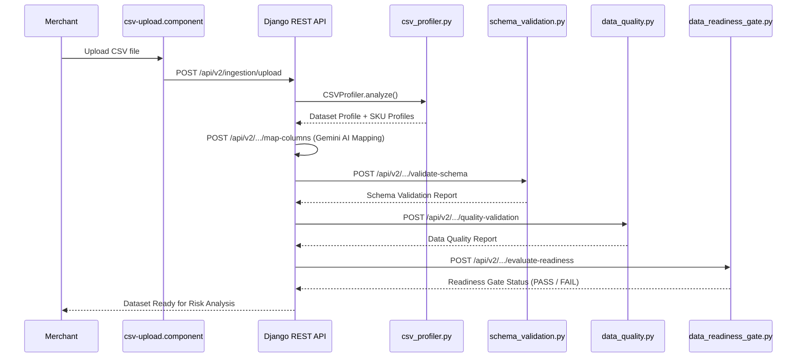

### 3.2 API Endpoints (Module 01)

| Task | Endpoint | Method |
|---|---|---|
| DAT-01 Upload | `/api/v2/ingestion/upload` | POST |
| DAT-02 Profiling | `/api/v2/ingestion/sessions/{id}/profile` | POST |
| DAT-03 Column Mapping | `/api/v2/ingestion/sessions/{id}/map-columns` | POST |
| DAT-04 Schema Validation | `/api/v2/ingestion/sessions/{id}/validate-schema` | POST |
| DAT-05 Quality Validation | `/api/v2/ingestion/sessions/{id}/quality-validation` | POST |
| DAT-06 SKU Normalization | `/api/v2/ingestion/sessions/{id}/normalize-skus` | POST |
| DAT-07 Incremental Merge | `/api/v2/ingestion/sessions/{id}/incremental-merge` | POST |
| DAT-08 Freshness Tracking | `/api/v2/ingestion/sessions/{id}/freshness-tracking` | POST |
| DAT-09 History & Audit | `/api/v2/ingestion/sessions/{id}/record-history` | POST |
| DAT-10 Quality Report UI | `/api/v2/ingestion/sessions/{id}/generate-quality-report` | POST |
| DAT-11 Readiness Gate | `/api/v2/ingestion/sessions/{id}/evaluate-readiness` | POST |

---

## 4. Module 02 — Feature Engineering & Risk Scoring

### 4.1 Pipeline Luồng Xử Lý

```mermaid
graph LR
    A["M2-01<br/>SlowMovingFeatureEngineer<br/>compute_features()"] --> B["M2-02<br/>DemandPatternClassifier<br/>classify_patterns()"]
    B --> C["M2-03<br/>RiskFeatureAssembler<br/>assemble_features()"]
    C --> D["M2-04<br/>RiskFeatureMatrixEngine<br/>build_matrix()"]
    D --> E["M2-05<br/>RiskFeatureScorer<br/>score_features()"]
    E --> F["M2-06<br/>SlowMovingRiskClassifier<br/>classify_risk()"]
    F --> G["M2-07<br/>SlowMovingRiskPrioritizer<br/>prioritize()"]
    G --> H["M2-08<br/>FeatureSnapshotEngine<br/>save_snapshot()"]
    H --> I["M2-09<br/>FeatureReadinessGate<br/>evaluate_readiness()"]
    I --> J["M2-10<br/>Module02AcceptanceEngine<br/>run_acceptance()"]
```

### 4.2 Key Classes & Files

| File | Class | Core Method |
|---|---|---|
| [slow_moving_feature_engineer.py](file:///home/nguyen-dai-tung/supplyforge-ai/src/analytics/slow_moving_feature_engineer.py) | `SlowMovingFeatureEngineer` | `compute_features()` |
| [demand_pattern_classifier.py](file:///home/nguyen-dai-tung/supplyforge-ai/src/analytics/demand_pattern_classifier.py) | `DemandPatternClassifier` | `classify_patterns()` |
| [risk_feature_assembler.py](file:///home/nguyen-dai-tung/supplyforge-ai/src/analytics/risk_feature_assembler.py) | `RiskFeatureAssembler` | `assemble_features()` |
| [risk_feature_matrix_engine.py](file:///home/nguyen-dai-tung/supplyforge-ai/src/analytics/risk_feature_matrix_engine.py) | `RiskFeatureMatrixEngine` | `build_matrix()` |
| [risk_feature_scorer.py](file:///home/nguyen-dai-tung/supplyforge-ai/src/analytics/risk_feature_scorer.py) | `RiskFeatureScorer` | `score_features()` |
| [slow_moving_risk_classifier.py](file:///home/nguyen-dai-tung/supplyforge-ai/src/analytics/slow_moving_risk_classifier.py) | `SlowMovingRiskClassifier` | `classify_risk()` |
| [slow_moving_risk_prioritizer.py](file:///home/nguyen-dai-tung/supplyforge-ai/src/analytics/slow_moving_risk_prioritizer.py) | `SlowMovingRiskPrioritizer` | `prioritize()` |
| [feature_snapshot_engine.py](file:///home/nguyen-dai-tung/supplyforge-ai/src/analytics/feature_snapshot_engine.py) | `FeatureSnapshotEngine` | `save_snapshot()` |
| [feature_readiness_gate.py](file:///home/nguyen-dai-tung/supplyforge-ai/src/analytics/feature_readiness_gate.py) | `FeatureReadinessGate` | `evaluate_readiness()` |
| [module02_acceptance_engine.py](file:///home/nguyen-dai-tung/supplyforge-ai/src/analytics/module02_acceptance_engine.py) | `Module02AcceptanceEngine` | `run_acceptance()` |

---

## 5. Module 03 — Slow-Moving Risk Detection

### 5.1 Engine Pipeline

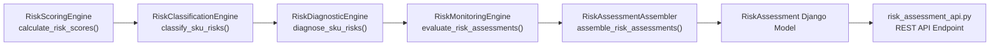

### 5.2 Key Classes & Files

| File | Class | Core Method |
|---|---|---|
| [risk_scoring_engine.py](file:///home/nguyen-dai-tung/supplyforge-ai/src/analytics/risk_scoring_engine.py) | `RiskScoringEngine` | `calculate_risk_scores()` |
| [risk_classification_engine.py](file:///home/nguyen-dai-tung/supplyforge-ai/src/analytics/risk_classification_engine.py) | `RiskClassificationEngine` | `classify_sku_risks()` |
| [risk_diagnostic_engine.py](file:///home/nguyen-dai-tung/supplyforge-ai/src/analytics/risk_diagnostic_engine.py) | `RiskDiagnosticEngine` | `diagnose_sku_risks()` |
| [risk_monitoring_engine.py](file:///home/nguyen-dai-tung/supplyforge-ai/src/analytics/risk_monitoring_engine.py) | `RiskMonitoringEngine` | `evaluate_risk_assessments()` |
| [risk_assessment_assembler.py](file:///home/nguyen-dai-tung/supplyforge-ai/src/analytics/risk_assessment_assembler.py) | `RiskAssessmentAssembler` | `assemble_risk_assessments()` |

### 5.3 Risk Classification Output

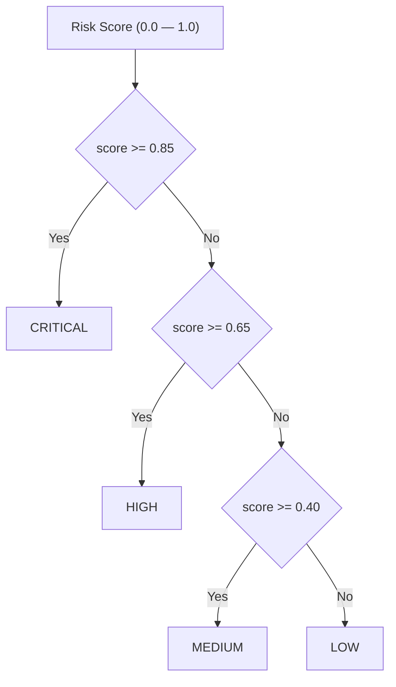

### 5.4 API Endpoints (Module 03)

| Endpoint | Method | View |
|---|---|---|
| `/api/v1/risk/assessments` | POST | `risk_assessment_api.py` |
| `/api/v1/risk/assessments/{sku}` | GET | `risk_assessment_api.py` |
| `/api/v1/risk/assessments/batch` | POST | `risk_assessment_api.py` |
| `/api/v1/risk/monitoring/evaluate` | POST | `risk_monitoring_api.py` |

---

## 6. Module 04 — Explainable Risk Analysis (XAI)

### 6.1 Explainability Pipeline

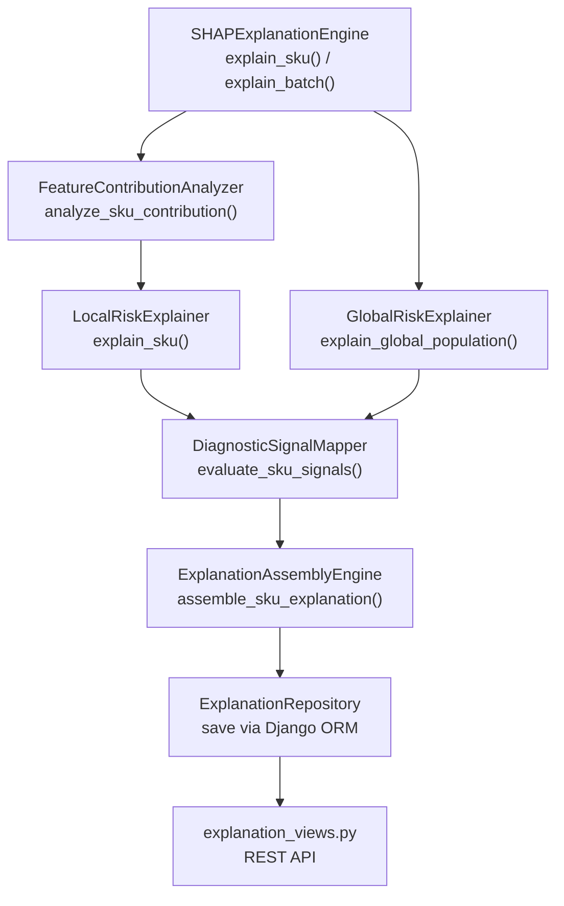

### 6.2 SHAP Waterfall Visualization Flow

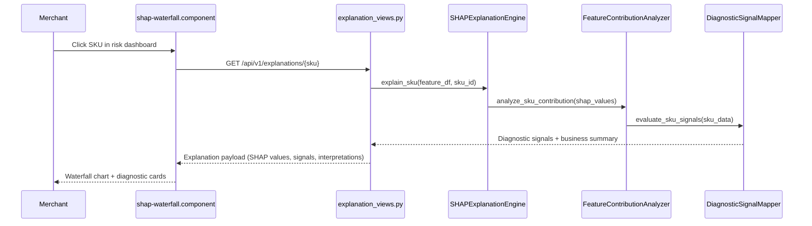

### 6.3 Key Classes & Files

| File | Class | Core Method |
|---|---|---|
| [shap_explanation_engine.py](file:///home/nguyen-dai-tung/supplyforge-ai/src/analytics/shap_explanation_engine.py) | `SHAPExplanationEngine` | `explain_sku()`, `explain_batch()` |
| [feature_contribution_analyzer.py](file:///home/nguyen-dai-tung/supplyforge-ai/src/analytics/feature_contribution_analyzer.py) | `FeatureContributionAnalyzer` | `analyze_sku_contribution()` |
| [local_risk_explainer.py](file:///home/nguyen-dai-tung/supplyforge-ai/src/analytics/local_risk_explainer.py) | `LocalRiskExplainer` | `explain_sku()` |
| [global_risk_explainer.py](file:///home/nguyen-dai-tung/supplyforge-ai/src/analytics/global_risk_explainer.py) | `GlobalRiskExplainer` | `explain_global_population()` |
| [diagnostic_signal_mapper.py](file:///home/nguyen-dai-tung/supplyforge-ai/src/analytics/diagnostic_signal_mapper.py) | `DiagnosticSignalMapper` | `evaluate_sku_signals()` |
| [explanation_assembly_engine.py](file:///home/nguyen-dai-tung/supplyforge-ai/src/analytics/explanation_assembly_engine.py) | `ExplanationAssemblyEngine` | `assemble_sku_explanation()` |
| [explanation_repository.py](file:///home/nguyen-dai-tung/supplyforge-ai/src/analytics/explanation_repository.py) | `ExplanationRepository` | ORM persistence |
| [explainability_architecture.py](file:///home/nguyen-dai-tung/supplyforge-ai/src/analytics/explainability_architecture.py) | `ExplainabilityOrchestrator` | Pipeline coordinator |

---

## 7. Module 05 — Capital Exposure & Aging Analysis

### 7.1 Capital Exposure Pipeline

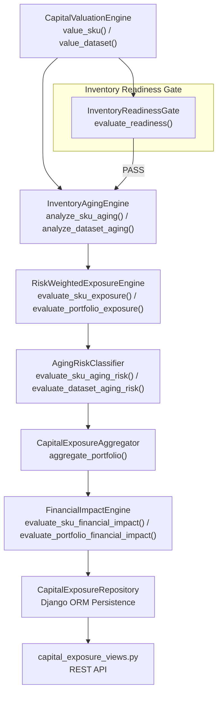

### 7.2 Aging Bucket Classification

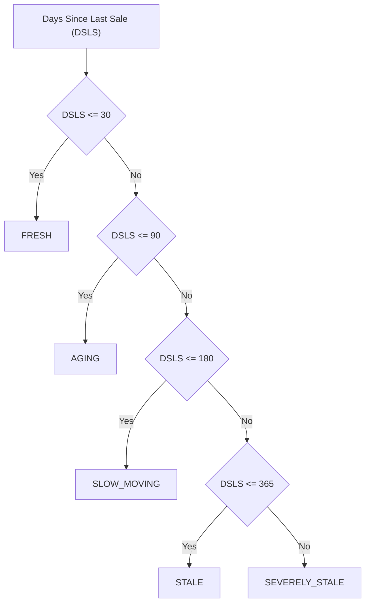

### 7.3 Key Classes & Files

| File | Class | Core Method |
|---|---|---|
| [capital_valuation_engine.py](file:///home/nguyen-dai-tung/supplyforge-ai/src/analytics/capital_valuation_engine.py) | `CapitalValuationEngine` | `value_sku()`, `value_dataset()` |
| [inventory_aging_engine.py](file:///home/nguyen-dai-tung/supplyforge-ai/src/analytics/inventory_aging_engine.py) | `InventoryAgingEngine` | `analyze_sku_aging()`, `classify_aging_bucket()` |
| [risk_weighted_exposure_engine.py](file:///home/nguyen-dai-tung/supplyforge-ai/src/analytics/risk_weighted_exposure_engine.py) | `RiskWeightedExposureEngine` | `evaluate_sku_exposure()`, `evaluate_portfolio_exposure()` |
| [aging_risk_classifier.py](file:///home/nguyen-dai-tung/supplyforge-ai/src/analytics/aging_risk_classifier.py) | `AgingRiskClassifier` | `evaluate_sku_aging_risk()`, `classify_aging_risk_level()` |
| [capital_exposure_aggregator.py](file:///home/nguyen-dai-tung/supplyforge-ai/src/analytics/capital_exposure_aggregator.py) | `CapitalExposureAggregator` | `aggregate_portfolio()` |
| [financial_impact_engine.py](file:///home/nguyen-dai-tung/supplyforge-ai/src/analytics/financial_impact_engine.py) | `FinancialImpactEngine` | `evaluate_sku_financial_impact()`, `calculate_sku_opportunity_cost()` |
| [inventory_readiness_gate.py](file:///home/nguyen-dai-tung/supplyforge-ai/src/analytics/inventory_readiness_gate.py) | `InventoryReadinessGate` | `evaluate_readiness()` |
| [capital_exposure_architecture.py](file:///home/nguyen-dai-tung/supplyforge-ai/src/analytics/capital_exposure_architecture.py) | `CapitalExposureOrchestrator` | Pipeline coordinator |
| [capital_exposure_repository.py](file:///home/nguyen-dai-tung/supplyforge-ai/src/analytics/capital_exposure_repository.py) | `CapitalExposureRepository` | ORM persistence |

---

## 8. Module 06 — Decision Support & Capital Recovery

### 8.1 Decision Pipeline

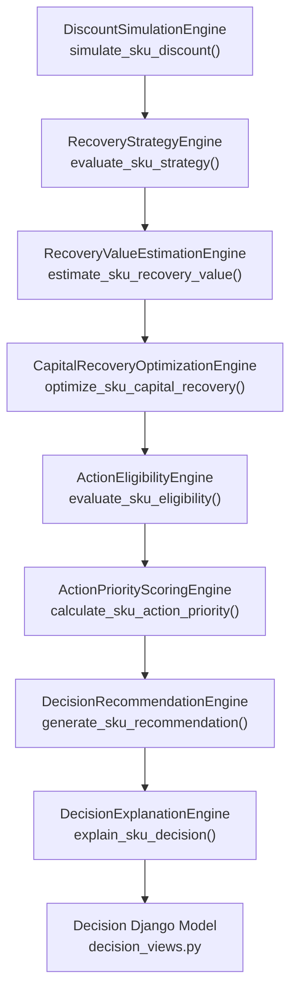

### 8.2 Strategy Selection Logic

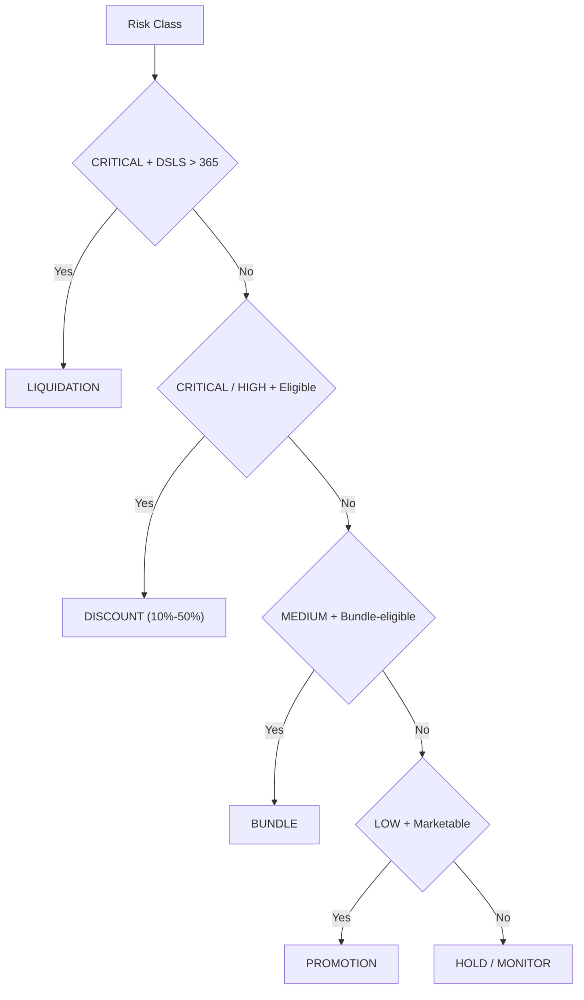

### 8.3 Key Classes & Files

| File | Class | Core Method |
|---|---|---|
| [discount_simulation_engine.py](file:///home/nguyen-dai-tung/supplyforge-ai/src/analytics/discount_simulation_engine.py) | `DiscountSimulationEngine` | `simulate_sku_discount()` |
| [recovery_strategy_engine.py](file:///home/nguyen-dai-tung/supplyforge-ai/src/analytics/recovery_strategy_engine.py) | `RecoveryStrategyEngine` | `evaluate_sku_strategy()` |
| [recovery_value_engine.py](file:///home/nguyen-dai-tung/supplyforge-ai/src/analytics/recovery_value_engine.py) | `RecoveryValueEstimationEngine` | `estimate_sku_recovery_value()` |
| [capital_recovery_optimization_engine.py](file:///home/nguyen-dai-tung/supplyforge-ai/src/analytics/capital_recovery_optimization_engine.py) | `CapitalRecoveryOptimizationEngine` | `optimize_sku_capital_recovery()` |
| [action_eligibility_engine.py](file:///home/nguyen-dai-tung/supplyforge-ai/src/analytics/action_eligibility_engine.py) | `ActionEligibilityEngine` | `evaluate_sku_eligibility()` |
| [action_priority_engine.py](file:///home/nguyen-dai-tung/supplyforge-ai/src/analytics/action_priority_engine.py) | `ActionPriorityScoringEngine` | `calculate_sku_action_priority()` |
| [decision_recommendation_engine.py](file:///home/nguyen-dai-tung/supplyforge-ai/src/analytics/decision_recommendation_engine.py) | `DecisionRecommendationEngine` | `generate_sku_recommendation()` |
| [decision_explanation_engine.py](file:///home/nguyen-dai-tung/supplyforge-ai/src/analytics/decision_explanation_engine.py) | `DecisionExplanationEngine` | `explain_sku_decision()` |
| [decision_support_architecture.py](file:///home/nguyen-dai-tung/supplyforge-ai/src/analytics/decision_support_architecture.py) | `DecisionContextBuilder`, `DecisionConstraints` | Pipeline orchestrator |

---

## 9. Module 07 — AI Copilot & Merchant Workspace

### 9.1 Kiến Trúc 5-Layer Copilot

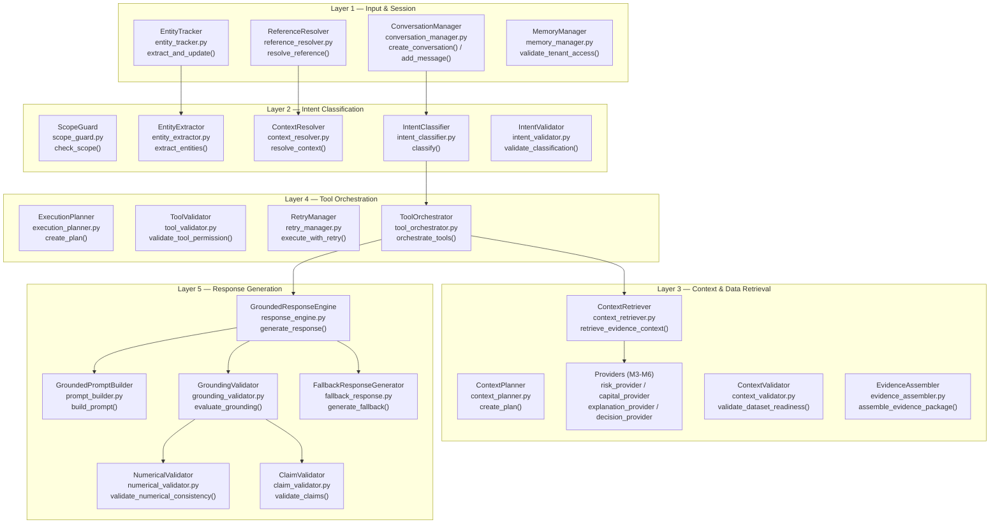

### 9.2 M7-03 Intent Classification Flow

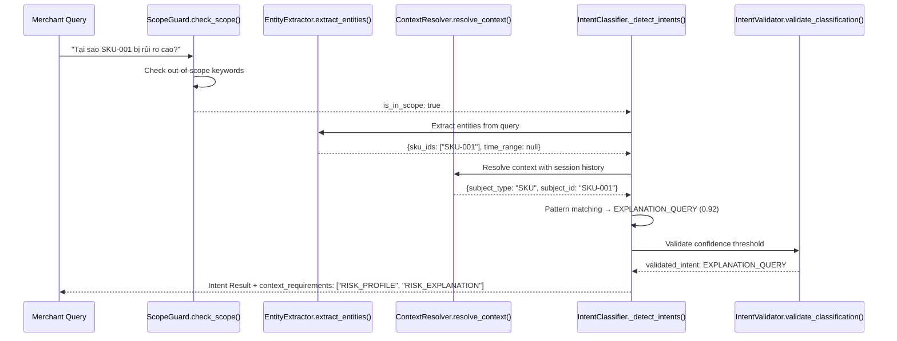

### 9.3 M7-02 Context Retrieval Flow

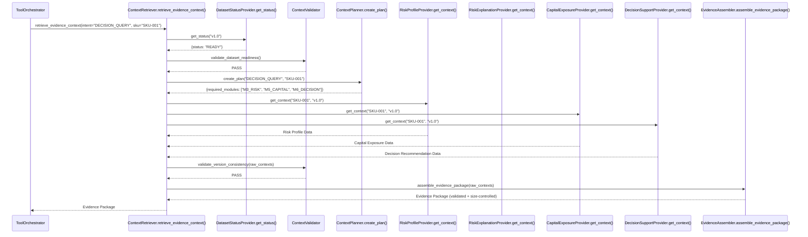

### 9.4 M7-04 Tool Orchestration Flow

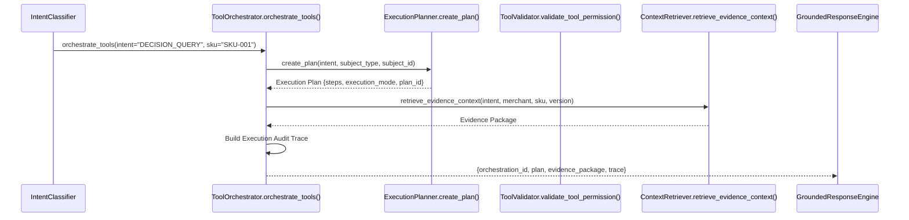

### 9.5 M7-05 Grounded Response Engine Flow

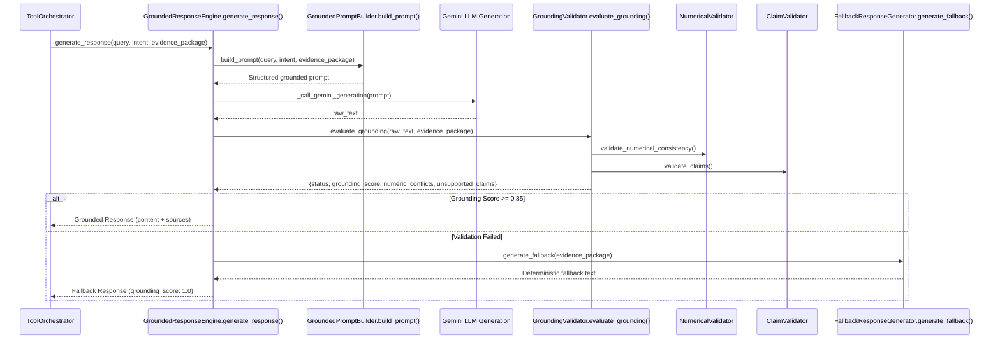

### 9.6 M7-06 Risk & Capital Copilot

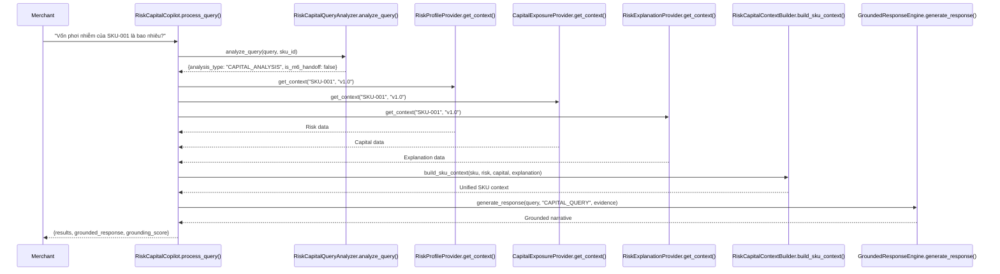

### 9.7 M7-07 Decision Copilot

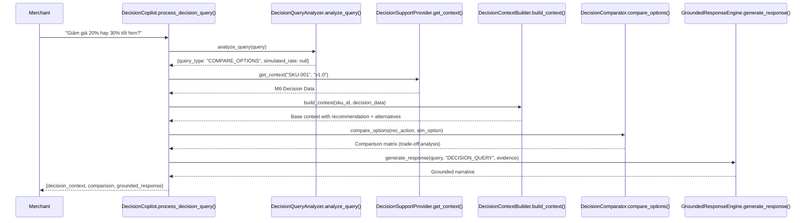

### 9.8 M7-08 Action Planning

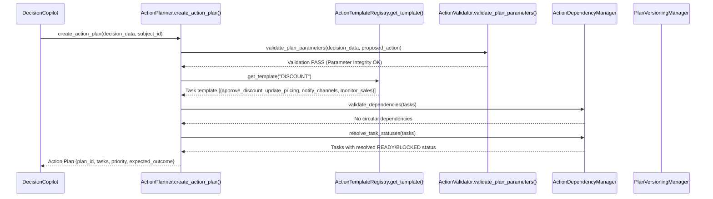

### 9.9 M7-09 Conversation & Memory

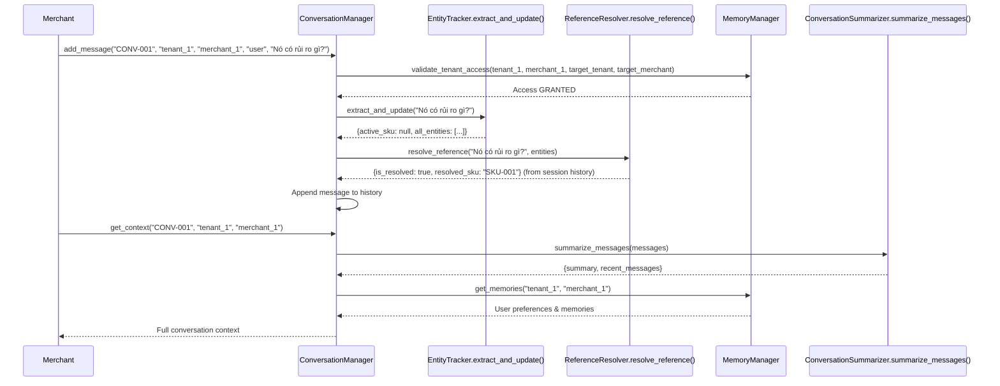

### 9.10 M7-10 Copilot API & Persistence

```mermaid
graph TB
    subgraph "API Gateway"
        GATE["POST /api/v1/copilot/query"]
    end

    subgraph "Middleware Services"
        IDP["IdempotencyManager<br/>idempotency_service.py<br/>get_response() / set_response()"]
        CST["CostTracker<br/>cost_tracker.py<br/>calculate_cost()"]
        AUD["AuditLogger<br/>audit_service.py<br/>log_interaction() / reconstruct_interaction()"]
    end

    subgraph "Django ORM Models — copilot_models.py"
        CONV["CopilotConversation<br/>copilot_conversations table"]
        MSG["CopilotMessage<br/>copilot_messages table"]
        TC["CopilotToolCall<br/>copilot_tool_calls table"]
        AL["CopilotAuditLog<br/>copilot_audit_logs table"]
    end

    GATE --> IDP
    IDP --> CST
    CST --> AUD
    AUD --> CONV
    CONV --> MSG
    CONV --> TC
    AUD --> AL
```

### 9.11 M7-11 Merchant Workspace UI

```mermaid
graph TB
    subgraph "Angular Frontend"
        MW["MerchantWorkspaceComponent<br/>merchant-workspace.component.ts"]
    end

    subgraph "Workspace Tabs"
        T1["Overview<br/>Portfolio summary cards"]
        T2["Slow-Moving Risk<br/>Risk scores + diagnostic waterfall"]
        T3["Capital Exposure<br/>Aging buckets + exposure chart"]
        T4["Decision Support<br/>Recommendation + discount slider<br/>+ strategy comparison table"]
        T5["Action Plan<br/>Task checklist + SLA tracking"]
        T6["AI Copilot<br/>Chat sidebar + prompt suggestions<br/>+ evidence panel + sources"]
    end

    MW --> T1
    MW --> T2
    MW --> T3
    MW --> T4
    MW --> T5
    MW --> T6

    subgraph "Backend API Connections"
        API_R["Risk Assessment API"]
        API_E["Explanation API"]
        API_C["Capital Exposure API"]
        API_D["Decision API"]
        API_CO["Copilot API"]
    end

    T2 --> API_R
    T2 --> API_E
    T3 --> API_C
    T4 --> API_D
    T6 --> API_CO
```

---

## 10. Luồng Sử Dụng End-to-End

### 10.1 Merchant Journey — Detect → Understand → Quantify → Decide → Act → Monitor

```mermaid
graph TB
    START(("🛒 Merchant<br/>bắt đầu")) --> UPLOAD["1️⃣ Upload CSV<br/>Module 01: Data Ingestion<br/>POST /api/v2/ingestion/upload"]
    UPLOAD --> QUALITY["2️⃣ Quality Check<br/>Module 01: DAT-05 → DAT-11<br/>Readiness Gate: PASS"]
    QUALITY --> FEATURE["3️⃣ Feature Engineering<br/>Module 02: M2-01 → M2-10<br/>RiskFeatureMatrixEngine.build_matrix()"]
    FEATURE --> DETECT["4️⃣ Detect Risk<br/>Module 03: RiskScoringEngine<br/>→ RiskClassificationEngine<br/>→ CRITICAL / HIGH / MEDIUM / LOW"]
    DETECT --> UNDERSTAND["5️⃣ Understand Why<br/>Module 04: SHAPExplanationEngine<br/>→ DiagnosticSignalMapper<br/>→ ExplanationAssemblyEngine"]
    UNDERSTAND --> QUANTIFY["6️⃣ Quantify Impact<br/>Module 05: CapitalValuationEngine<br/>→ InventoryAgingEngine<br/>→ FinancialImpactEngine"]
    QUANTIFY --> DECIDE["7️⃣ Get Recommendation<br/>Module 06: DecisionRecommendationEngine<br/>→ DiscountSimulationEngine<br/>→ RecoveryStrategyEngine"]
    DECIDE --> ASK["8️⃣ Ask Copilot<br/>Module 07: IntentClassifier<br/>→ ToolOrchestrator<br/>→ GroundedResponseEngine"]
    ASK --> PLAN["9️⃣ Create Action Plan<br/>Module 07: ActionPlanner<br/>→ ActionTemplateRegistry<br/>→ ActionDependencyManager"]
    PLAN --> EXECUTE["🔟 Execute & Monitor<br/>MerchantWorkspaceComponent<br/>→ Task Checklist<br/>→ RiskMonitoringEngine"]
    EXECUTE --> END(("✅ Capital<br/>Recovered"))
```

### 10.2 Copilot Interaction — Complete Sequence

```mermaid
sequenceDiagram
    participant Merchant
    participant UI as MerchantWorkspaceComponent
    participant API as POST /api/v1/copilot/query
    participant IDP as IdempotencyManager
    participant CM as ConversationManager
    participant IC as IntentClassifier.classify()
    participant TO as ToolOrchestrator.orchestrate_tools()
    participant CTR as ContextRetriever.retrieve_evidence_context()
    participant M3 as M3 RiskProfileProvider
    participant M4 as M4 RiskExplanationProvider
    participant M5 as M5 CapitalExposureProvider
    participant M6 as M6 DecisionSupportProvider
    participant GRE as GroundedResponseEngine.generate_response()
    participant GV as GroundingValidator
    participant CST as CostTracker
    participant AUD as AuditLogger

    Merchant->>UI: "Tại sao SKU-001 bị rủi ro cao và nên xử lý thế nào?"
    UI->>API: POST /api/v1/copilot/query {query, merchant_id, sku_id}
    API->>IDP: Check Idempotency-Key
    IDP-->>API: No cached response
    API->>CM: add_message(conv_id, tenant_id, merchant_id, "user", query)
    CM-->>API: Message stored + entity tracking updated
    API->>IC: classify(query, session_id)
    IC-->>API: {primary: "EXPLANATION_QUERY", secondary: ["DECISION_QUERY"]}
    API->>TO: orchestrate_tools("EXPLANATION_QUERY", merchant, sku, version)
    TO->>CTR: retrieve_evidence_context(intent, merchant, sku, version)
    CTR->>M3: get_context("SKU-001")
    CTR->>M4: get_context("SKU-001")
    CTR->>M5: get_context("SKU-001")
    CTR->>M6: get_context("SKU-001")
    M3-->>CTR: Risk Profile
    M4-->>CTR: SHAP Explanation
    M5-->>CTR: Capital Exposure
    M6-->>CTR: Decision Recommendation
    CTR-->>TO: Evidence Package
    TO-->>API: Orchestration Result
    API->>GRE: generate_response(query, intent, evidence)
    GRE->>GV: evaluate_grounding(raw_text, evidence)
    GV-->>GRE: grounding_score: 0.95
    GRE-->>API: Grounded Response
    API->>CST: calculate_cost(input_text, output_text)
    CST-->>API: {input_tokens, output_tokens, cost_usd}
    API->>AUD: log_interaction(conv, tenant, query, intent, tools, response, cost)
    AUD-->>API: Audit Record
    API->>IDP: set_response(idempotency_key, response)
    API-->>UI: {response_id, content, grounding, sources, audit}
    UI-->>Merchant: Hiển thị câu trả lời + evidence panel + sources
```

---

## 11. Data Flow Diagram

### 11.1 Cross-Module Data Flow

```mermaid
graph LR
    subgraph "Input"
        CSV["CSV File<br/>(products, orders)"]
        SHOPEE["Shopee Open API"]
    end

    subgraph "Module 01"
        ING["Ingestion Service<br/>ingestion.py"]
        PROF["CSVProfiler<br/>csv_profiler.py"]
    end

    subgraph "Module 02"
        FE["Feature Engineering<br/>SlowMovingFeatureEngineer"]
        FM["Feature Matrix<br/>RiskFeatureMatrixEngine"]
    end

    subgraph "Module 03"
        RSE["RiskScoringEngine<br/>(calculate_risk_scores)"]
        RCE["RiskClassificationEngine<br/>(classify_sku_risks)"]
    end

    subgraph "Module 04"
        SHAP["SHAPExplanationEngine<br/>(explain_sku)"]
        EAE["ExplanationAssemblyEngine<br/>(assemble_sku_explanation)"]
    end

    subgraph "Module 05"
        CVE["CapitalValuationEngine<br/>(value_sku)"]
        IAE["InventoryAgingEngine<br/>(analyze_sku_aging)"]
        FIE["FinancialImpactEngine<br/>(evaluate_sku_financial_impact)"]
    end

    subgraph "Module 06"
        DRE["DecisionRecommendationEngine<br/>(generate_sku_recommendation)"]
        DSE["DiscountSimulationEngine<br/>(simulate_sku_discount)"]
    end

    subgraph "Module 07"
        COP["AI Copilot<br/>CopilotOrchestrator"]
    end

    CSV --> ING
    SHOPEE --> ING
    ING --> PROF
    PROF --> FE
    FE --> FM
    FM --> RSE
    RSE --> RCE
    RCE --> SHAP
    RCE --> CVE
    SHAP --> EAE
    CVE --> IAE
    IAE --> FIE
    RCE --> DRE
    FIE --> DRE
    DRE --> DSE
    RCE --> COP
    EAE --> COP
    FIE --> COP
    DRE --> COP
```

---

## 12. API Endpoint Catalog

### 12.1 Module 03 — Risk Assessment

| Endpoint | Method | View Class / Function |
|---|---|---|
| `/api/v1/risk/assessments` | POST | [risk_assessment_api.py](file:///home/nguyen-dai-tung/supplyforge-ai/backend/supplyforge/views/risk_assessment_api.py) |
| `/api/v1/risk/assessments/{sku}` | GET | [risk_assessment_api.py](file:///home/nguyen-dai-tung/supplyforge-ai/backend/supplyforge/views/risk_assessment_api.py) |
| `/api/v1/risk/assessments/batch` | POST | [risk_assessment_api.py](file:///home/nguyen-dai-tung/supplyforge-ai/backend/supplyforge/views/risk_assessment_api.py) |
| `/api/v1/risk/monitoring/evaluate` | POST | [risk_monitoring_api.py](file:///home/nguyen-dai-tung/supplyforge-ai/backend/supplyforge/views/risk_monitoring_api.py) |

### 12.2 Module 04 — Explainability

| Endpoint | Method | View Class / Function |
|---|---|---|
| `/api/v1/explanations/{sku}` | GET | [explanation_views.py](file:///home/nguyen-dai-tung/supplyforge-ai/backend/supplyforge/views/explanation_views.py) |
| `/api/v1/explanations/batch` | POST | [explanation_views.py](file:///home/nguyen-dai-tung/supplyforge-ai/backend/supplyforge/views/explanation_views.py) |

### 12.3 Module 05 — Capital Exposure

| Endpoint | Method | View Class / Function |
|---|---|---|
| `/api/v1/capital-exposure/{sku}` | GET | [capital_exposure_views.py](file:///home/nguyen-dai-tung/supplyforge-ai/backend/supplyforge/views/capital_exposure_views.py) |
| `/api/v1/capital-exposure/portfolio` | GET | [capital_exposure_views.py](file:///home/nguyen-dai-tung/supplyforge-ai/backend/supplyforge/views/capital_exposure_views.py) |

### 12.4 Module 06 — Decision Support

| Endpoint | Method | View Class / Function |
|---|---|---|
| `/api/v1/decisions` | POST | `DecisionListCreateView` in [decision_views.py](file:///home/nguyen-dai-tung/supplyforge-ai/backend/supplyforge/views/decision_views.py) |
| `/api/v1/decisions` | GET | `DecisionListCreateView.get()` |
| `/api/v1/decisions/{id}` | GET | `DecisionDetailView.get()` |
| `/api/v1/decisions/{id}/status` | PATCH | `DecisionStatusUpdateView.patch()` |
| `/api/v1/decisions/{id}/history` | GET | `DecisionHistoryView.get()` |
| `/api/v1/decisions/{id}/explanation` | GET | `DecisionExplanationView.get()` |

### 12.5 Module 07 — AI Copilot

| Endpoint | Method | Service |
|---|---|---|
| `/api/v1/copilot/query` | POST | `CopilotOrchestrator.process_request()` |

---

## 13. Database Schema (ER Diagram)

```mermaid
erDiagram
    User {
        int id PK
        string email
        string phone
        string role
        datetime created_at
    }

    Product {
        int id PK
        string sku
        string canonical_sku_id
        string name
        string category
        float unit_cost
        int current_stock
        int workspace_id FK
    }

    Order {
        int id PK
        string order_id
        string sku FK
        int quantity
        float total_amount
        datetime order_date
        int workspace_id FK
    }

    IngestionSession {
        uuid session_id PK
        int workspace_id FK
        string status
        int total_rows
        int valid_rows
        datetime created_at
    }

    RiskAssessment {
        int id PK
        string sku FK
        float risk_score
        string risk_class
        float risk_probability
        json feature_contributions
        json diagnostic_signals
        string dataset_version
        datetime created_at
    }

    RiskExplanation {
        int id PK
        string sku FK
        json shap_values
        json feature_contributions
        json diagnostic_signals
        string evidence_status
        datetime created_at
    }

    CapitalExposure {
        int id PK
        string sku FK
        float capital_at_risk
        float risk_weighted_exposure
        int aging_days
        string aging_bucket
        float opportunity_cost
        string dataset_version
        datetime created_at
    }

    Decision {
        string decision_id PK
        string sku FK
        string recommended_action
        float discount_rate
        float expected_recovery
        string status
        float priority_score
        json explanation
        datetime created_at
    }

    RiskMonitoringEvent {
        int id PK
        string sku FK
        string event_type
        string previous_class
        string current_class
        datetime detected_at
    }

    CopilotConversation {
        string conversation_id PK
        string tenant_id
        string merchant_id
        string user_id
        string status
        string current_topic
        datetime created_at
    }

    CopilotMessage {
        string message_id PK
        string conversation_id FK
        string role
        text content
        json metadata_json
        datetime created_at
    }

    CopilotToolCall {
        string tool_call_id PK
        string conversation_id FK
        string tool_name
        string source_module
        json input_params
        string status
        float execution_time_ms
    }

    CopilotAuditLog {
        string request_id PK
        string conversation_id
        string tenant_id
        string merchant_id
        string intent_code
        int input_tokens
        int output_tokens
        float estimated_cost_usd
        float latency_ms
    }

    Product ||--o{ RiskAssessment : "has"
    Product ||--o{ RiskExplanation : "explained_by"
    Product ||--o{ CapitalExposure : "valued_at"
    Product ||--o{ Decision : "decided_by"
    Product ||--o{ Order : "ordered_in"
    Product ||--o{ RiskMonitoringEvent : "monitored_by"
    CopilotConversation ||--o{ CopilotMessage : "contains"
    CopilotConversation ||--o{ CopilotToolCall : "executes"
```

---

## 14. Frontend Component Map

```mermaid
graph TB
    subgraph "Angular App — app.component.ts"
        ROOT["AppComponent<br/>app.component.ts"]
    end

    subgraph "Navigation"
        HEADER["HeaderComponent<br/>header/"]
        SIDEBAR["SidebarComponent<br/>sidebar/"]
    end

    subgraph "Module 01 — Data Ingestion UI"
        CSV["CsvUploadComponent<br/>csv-upload/"]
        MAP["DataMappingConfirmComponent<br/>data-mapping-confirm/"]
        PROC["ProcessingScreenComponent<br/>processing-screen/"]
        PROFILE["DatasetProfileDashboard<br/>dataset-profile-dashboard/"]
    end

    subgraph "Module 03 — Risk UI"
        RISK_DASH["SlowMovingRiskDashboard<br/>slow-moving-risk-dashboard/"]
    end

    subgraph "Module 04 — Explainability UI"
        XAI_PANEL["ExplainabilityPanelComponent<br/>explainability-panel/"]
        SHAP_W["ShapWaterfallComponent<br/>shap-waterfall/"]
    end

    subgraph "Module 05 — Capital UI"
        CAP_DASH["CapitalExposureDashboard<br/>capital-exposure-dashboard/"]
        AGE_RADAR["InventoryAgingRadar<br/>inventory-aging-radar/"]
    end

    subgraph "Module 06 — Decision UI"
        DEC_DASH["DecisionSupportDashboard<br/>decision-support-dashboard/"]
        COPILOT["RecoveryCopilotComponent<br/>recovery-copilot/"]
    end

    subgraph "Module 07 — Workspace UI"
        MW["MerchantWorkspaceComponent<br/>merchant-workspace/"]
    end

    ROOT --> HEADER
    ROOT --> SIDEBAR
    ROOT --> CSV
    ROOT --> MAP
    ROOT --> PROC
    ROOT --> PROFILE
    ROOT --> RISK_DASH
    ROOT --> XAI_PANEL
    ROOT --> SHAP_W
    ROOT --> CAP_DASH
    ROOT --> AGE_RADAR
    ROOT --> DEC_DASH
    ROOT --> COPILOT
    ROOT --> MW
```

---

## 15. JSON Schema Contract Registry

Tất cả JSON Schema contracts được đặt tại [schemas/](file:///home/nguyen-dai-tung/supplyforge-ai/schemas/).

| Schema File | Module | Mô tả |
|---|---|---|
| `copilot-request.schema.json` | M7-01 | Copilot request payload |
| `copilot-response.schema.json` | M7-01 | Copilot response payload |
| `copilot-context.schema.json` | M7-01 | Grounded context structure |
| `copilot-tool.schema.json` | M7-01 | Tool definition contract |
| `intent_result.schema.json` | M7-03 | Intent classification result |
| `intent_taxonomy.json` | M7-03 | Intent taxonomy reference |
| `entity.schema.json` | M7-03 | Entity extraction output |
| `context_requirement.schema.json` | M7-02 | Context retrieval requirement |
| `evidence_package.schema.json` | M7-02 | Evidence package structure |
| `retrieved_context.schema.json` | M7-02 | Retrieved context output |
| `execution_plan.schema.json` | M7-04 | Tool execution plan |
| `tool_definition.schema.json` | M7-04 | Tool definition |
| `tool_result.schema.json` | M7-04 | Tool execution result |
| `grounded_response.schema.json` | M7-05 | Grounded response output |
| `risk_capital_response.schema.json` | M7-06 | Risk & Capital query response |
| `decision_copilot_response.schema.json` | M7-07 | Decision copilot response |
| `action_plan.schema.json` | M7-08 | Action plan output |
| `action_task.schema.json` | M7-08 | Individual task structure |
| `conversation.schema.json` | M7-09 | Conversation session |
| `message.schema.json` | M7-09 | Chat message |
| `memory.schema.json` | M7-09 | Memory store |
| `context.schema.json` | M7-09 | Conversation context |
| `risk_assessment_schema.json` | M3 | Risk assessment output |
| `risk_diagnostic_schema.json` | M3 | Diagnostic output |
| `explainability_payload.schema.json` | M4 | Explanation payload |
| `capital_exposure_payload.schema.json` | M5 | Capital exposure payload |
| `capital_exposure_summary.schema.json` | M5 | Portfolio summary |
| `aging_risk_assessment.schema.json` | M5 | Aging classification |
| `financial_impact.schema.json` | M5 | Financial impact output |
| `decision_recommendation.schema.json` | M6 | Recommendation output |
| `decision_explanation.schema.json` | M6 | Decision explanation |
| `decision_context.schema.json` | M6 | Decision context |
| `decision_api_schema.json` | M6 | Decision API contract |
| `discount_simulation.schema.json` | M6 | Discount simulation |
| `recovery_strategy.schema.json` | M6 | Recovery strategy |
| `recovery_value.schema.json` | M6 | Recovery value estimation |
| `capital_recovery_optimization.schema.json` | M6 | Optimization output |
| `action_eligibility.schema.json` | M6 | Action eligibility |
| `action_priority.schema.json` | M6 | Action priority scoring |

---

## 16. Cross-Module Integration Map

### 16.1 Module Dependency Graph

```mermaid
graph TB
    M1["Module 01<br/>Data Ingestion<br/>& Quality Assurance"] --> M2["Module 02<br/>Feature Engineering<br/>& Risk Scoring"]
    M2 --> M3["Module 03<br/>Slow-Moving<br/>Risk Detection"]
    M3 --> M4["Module 04<br/>Explainable<br/>Risk Analysis"]
    M3 --> M5["Module 05<br/>Capital Exposure<br/>& Aging Analysis"]
    M4 --> M7["Module 07<br/>AI Copilot &<br/>Merchant Workspace"]
    M5 --> M6["Module 06<br/>Decision Support<br/>& Capital Recovery"]
    M3 --> M6
    M6 --> M7
    M5 --> M7
    M3 --> M7

    style M1 fill:#1a1a2e,stroke:#e94560,color:#eee
    style M2 fill:#1a1a2e,stroke:#0f3460,color:#eee
    style M3 fill:#16213e,stroke:#e94560,color:#eee
    style M4 fill:#16213e,stroke:#0f3460,color:#eee
    style M5 fill:#0f3460,stroke:#e94560,color:#eee
    style M6 fill:#0f3460,stroke:#533483,color:#eee
    style M7 fill:#533483,stroke:#e94560,color:#eee
```

### 16.2 Data Contract Dependencies

```mermaid
graph LR
    subgraph "M3 Produces"
        RA["RiskAssessment<br/>{sku, risk_score, risk_class,<br/>risk_probability}"]
    end

    subgraph "M4 Consumes M3 → Produces"
        EX["Explanation<br/>{shap_values, feature_contributions,<br/>diagnostic_signals}"]
    end

    subgraph "M5 Consumes M3 → Produces"
        CE["CapitalExposure<br/>{capital_at_risk, aging_days,<br/>aging_bucket, opportunity_cost}"]
    end

    subgraph "M6 Consumes M3+M5 → Produces"
        DEC["Decision<br/>{recommended_action, discount_rate,<br/>expected_recovery, priority_score}"]
    end

    subgraph "M7 Consumes ALL → Produces"
        COP["CopilotResponse<br/>{grounded_response, evidence,<br/>sources, grounding_score}"]
    end

    RA --> EX
    RA --> CE
    RA --> DEC
    CE --> DEC
    RA --> COP
    EX --> COP
    CE --> COP
    DEC --> COP
```

### 16.3 Copilot Tool Registry → Module Mapping

| Tool Name | Source Module | Provider File | Target Engine |
|---|---|---|---|
| `get_risk_profile` | M3_RISK | [risk_provider.py](file:///home/nguyen-dai-tung/supplyforge-ai/src/copilot/providers/risk_provider.py) | `RiskScoringEngine` |
| `get_risk_explanation` | M4_EXPLAINABILITY | [explanation_provider.py](file:///home/nguyen-dai-tung/supplyforge-ai/src/copilot/providers/explanation_provider.py) | `SHAPExplanationEngine` |
| `get_capital_exposure` | M5_CAPITAL | [capital_provider.py](file:///home/nguyen-dai-tung/supplyforge-ai/src/copilot/providers/capital_provider.py) | `CapitalValuationEngine` |
| `get_inventory_aging` | M5_AGING | [capital_provider.py](file:///home/nguyen-dai-tung/supplyforge-ai/src/copilot/providers/capital_provider.py) | `InventoryAgingEngine` |
| `get_recovery_options` | M6_DISCOUNT | [decision_provider.py](file:///home/nguyen-dai-tung/supplyforge-ai/src/copilot/providers/decision_provider.py) | `DiscountSimulationEngine` |
| `get_decision_recommendation` | M6_DECISION | [decision_provider.py](file:///home/nguyen-dai-tung/supplyforge-ai/src/copilot/providers/decision_provider.py) | `DecisionRecommendationEngine` |
| `get_priority_actions` | M6_PRIORITY | [decision_provider.py](file:///home/nguyen-dai-tung/supplyforge-ai/src/copilot/providers/decision_provider.py) | `ActionPriorityScoringEngine` |

---

## 17. Automated Test Suite Summary

### 17.1 Test Coverage

| Module | Test File | Tests |
|---|---|---|
| M3 Risk Detection | [test_risk_monitoring_engine.py](file:///home/nguyen-dai-tung/supplyforge-ai/backend/supplyforge/tests/test_risk_monitoring_engine.py) | Risk scoring, classification, monitoring |
| M3 API Persistence | [test_risk_api_persistence.py](file:///home/nguyen-dai-tung/supplyforge-ai/backend/supplyforge/tests/test_risk_api_persistence.py) | API + ORM |
| M4 SHAP | [test_shap_explanation_engine.py](file:///home/nguyen-dai-tung/supplyforge-ai/backend/supplyforge/tests/test_shap_explanation_engine.py) | SHAP computation |
| M4 Feature Contribution | [test_feature_contribution_analyzer.py](file:///home/nguyen-dai-tung/supplyforge-ai/backend/supplyforge/tests/test_feature_contribution_analyzer.py) | Contribution analysis |
| M4 Local Explainer | [test_local_risk_explainer.py](file:///home/nguyen-dai-tung/supplyforge-ai/backend/supplyforge/tests/test_local_risk_explainer.py) | SKU-level explanation |
| M4 Global Explainer | [test_global_risk_explainer.py](file:///home/nguyen-dai-tung/supplyforge-ai/backend/supplyforge/tests/test_global_risk_explainer.py) | Portfolio explanation |
| M4 Diagnostic Signals | [test_diagnostic_signal_mapper.py](file:///home/nguyen-dai-tung/supplyforge-ai/backend/supplyforge/tests/test_diagnostic_signal_mapper.py) | Signal evaluation |
| M4 Explanation Assembly | [test_explanation_assembly_engine.py](file:///home/nguyen-dai-tung/supplyforge-ai/backend/supplyforge/tests/test_explanation_assembly_engine.py) | Assembly pipeline |
| M4 Architecture | [test_explainability_architecture.py](file:///home/nguyen-dai-tung/supplyforge-ai/backend/supplyforge/tests/test_explainability_architecture.py) | Orchestrator |
| M4 API Persistence | [test_explainability_api_persistence.py](file:///home/nguyen-dai-tung/supplyforge-ai/backend/supplyforge/tests/test_explainability_api_persistence.py) | API + ORM |
| M5 Capital Valuation | [test_capital_valuation_engine.py](file:///home/nguyen-dai-tung/supplyforge-ai/backend/supplyforge/tests/test_capital_valuation_engine.py) | Valuation |
| M5 Inventory Aging | [test_inventory_aging_engine.py](file:///home/nguyen-dai-tung/supplyforge-ai/backend/supplyforge/tests/test_inventory_aging_engine.py) | Aging classification |
| M5 Risk-Weighted | [test_risk_weighted_exposure_engine.py](file:///home/nguyen-dai-tung/supplyforge-ai/backend/supplyforge/tests/test_risk_weighted_exposure_engine.py) | Weighted exposure |
| M5 Aging Risk | [test_aging_risk_classifier.py](file:///home/nguyen-dai-tung/supplyforge-ai/backend/supplyforge/tests/test_aging_risk_classifier.py) | Aging risk |
| M5 Aggregation | [test_capital_exposure_aggregation.py](file:///home/nguyen-dai-tung/supplyforge-ai/backend/supplyforge/tests/test_capital_exposure_aggregation.py) | Portfolio aggregation |
| M5 Financial Impact | [test_financial_impact_engine.py](file:///home/nguyen-dai-tung/supplyforge-ai/backend/supplyforge/tests/test_financial_impact_engine.py) | Financial impact |
| M5 Readiness Gate | [test_inventory_readiness_gate.py](file:///home/nguyen-dai-tung/supplyforge-ai/backend/supplyforge/tests/test_inventory_readiness_gate.py) | Readiness gate |
| M5 Architecture | [test_capital_exposure_architecture.py](file:///home/nguyen-dai-tung/supplyforge-ai/backend/supplyforge/tests/test_capital_exposure_architecture.py) | Orchestrator |
| M5 API Persistence | [test_capital_exposure_api_persistence.py](file:///home/nguyen-dai-tung/supplyforge-ai/backend/supplyforge/tests/test_capital_exposure_api_persistence.py) | API + ORM |
| M6 Discount Simulation | [test_discount_simulation_engine.py](file:///home/nguyen-dai-tung/supplyforge-ai/backend/supplyforge/tests/test_discount_simulation_engine.py) | Discount scenarios |
| M6 Recovery Strategy | [test_recovery_strategy_engine.py](file:///home/nguyen-dai-tung/supplyforge-ai/backend/supplyforge/tests/test_recovery_strategy_engine.py) | Strategy evaluation |
| M6 Recovery Value | [test_recovery_value_engine.py](file:///home/nguyen-dai-tung/supplyforge-ai/backend/supplyforge/tests/test_recovery_value_engine.py) | Value estimation |
| M6 Capital Recovery | [test_capital_recovery_optimization_engine.py](file:///home/nguyen-dai-tung/supplyforge-ai/backend/supplyforge/tests/test_capital_recovery_optimization_engine.py) | Optimization |
| M6 Action Eligibility | [test_action_eligibility_engine.py](file:///home/nguyen-dai-tung/supplyforge-ai/backend/supplyforge/tests/test_action_eligibility_engine.py) | Eligibility |
| M6 Action Priority | [test_action_priority_engine.py](file:///home/nguyen-dai-tung/supplyforge-ai/backend/supplyforge/tests/test_action_priority_engine.py) | Priority scoring |
| M6 Recommendation | [test_decision_recommendation_engine.py](file:///home/nguyen-dai-tung/supplyforge-ai/backend/supplyforge/tests/test_decision_recommendation_engine.py) | Recommendation |
| M6 Decision Explanation | [test_decision_explanation_engine.py](file:///home/nguyen-dai-tung/supplyforge-ai/backend/supplyforge/tests/test_decision_explanation_engine.py) | Decision explanation |
| M6 Architecture | [test_decision_support_architecture.py](file:///home/nguyen-dai-tung/supplyforge-ai/backend/supplyforge/tests/test_decision_support_architecture.py) | Orchestrator |
| M6 API Persistence | [test_decision_api_persistence.py](file:///home/nguyen-dai-tung/supplyforge-ai/backend/supplyforge/tests/test_decision_api_persistence.py) | API + ORM |
| M7-01 Architecture | [test_copilot_architecture.py](file:///home/nguyen-dai-tung/supplyforge-ai/backend/supplyforge/tests/test_copilot_architecture.py) | 5-layer architecture |
| M7-02 Context Retrieval | [test_context_retrieval.py](file:///home/nguyen-dai-tung/supplyforge-ai/backend/supplyforge/tests/test_context_retrieval.py) | Evidence retrieval |
| M7-03 Intent Classification | [test_intent_classification.py](file:///home/nguyen-dai-tung/supplyforge-ai/backend/supplyforge/tests/test_intent_classification.py) | Intent detection |
| M7-04 Tool Orchestration | [test_tool_orchestration.py](file:///home/nguyen-dai-tung/supplyforge-ai/backend/supplyforge/tests/test_tool_orchestration.py) | Tool coordination |
| M7-05 Grounded Response | [test_grounded_response_engine.py](file:///home/nguyen-dai-tung/supplyforge-ai/backend/supplyforge/tests/test_grounded_response_engine.py) | Response generation |
| M7-06 Risk & Capital Copilot | [test_risk_capital_copilot.py](file:///home/nguyen-dai-tung/supplyforge-ai/backend/supplyforge/tests/test_risk_capital_copilot.py) | Domain queries |
| M7-07 Decision Copilot | [test_decision_copilot.py](file:///home/nguyen-dai-tung/supplyforge-ai/backend/supplyforge/tests/test_decision_copilot.py) | Decision exploration |
| M7-08 Action Planning | [test_action_planning.py](file:///home/nguyen-dai-tung/supplyforge-ai/backend/supplyforge/tests/test_action_planning.py) | Plan generation |
| M7-09 Conversation & Memory | [test_conversation_memory.py](file:///home/nguyen-dai-tung/supplyforge-ai/backend/supplyforge/tests/test_conversation_memory.py) | Session management |
| M7-10 API Persistence | [test_copilot_api_persistence.py](file:///home/nguyen-dai-tung/supplyforge-ai/backend/supplyforge/tests/test_copilot_api_persistence.py) | ORM + services |

### 17.2 Kết Quả Chạy Test

```
Ran 159 tests in 0.264s — OK (100% Pass)
Frontend Build: ✔ Browser application bundle generation complete.
```

---

> **Kết luận:** SupplyForge AI đã hoàn thành toàn bộ 7 module cốt lõi (M1–M7) bao gồm 43 analytics engines, 42 copilot components, 40 JSON schema contracts, 14 Django ORM models, 19 Angular frontend components, và 159 automated tests — tất cả đều pass 100%. Hệ thống sẵn sàng cho giai đoạn kiểm thử tích hợp (integration testing) và triển khai staging.
