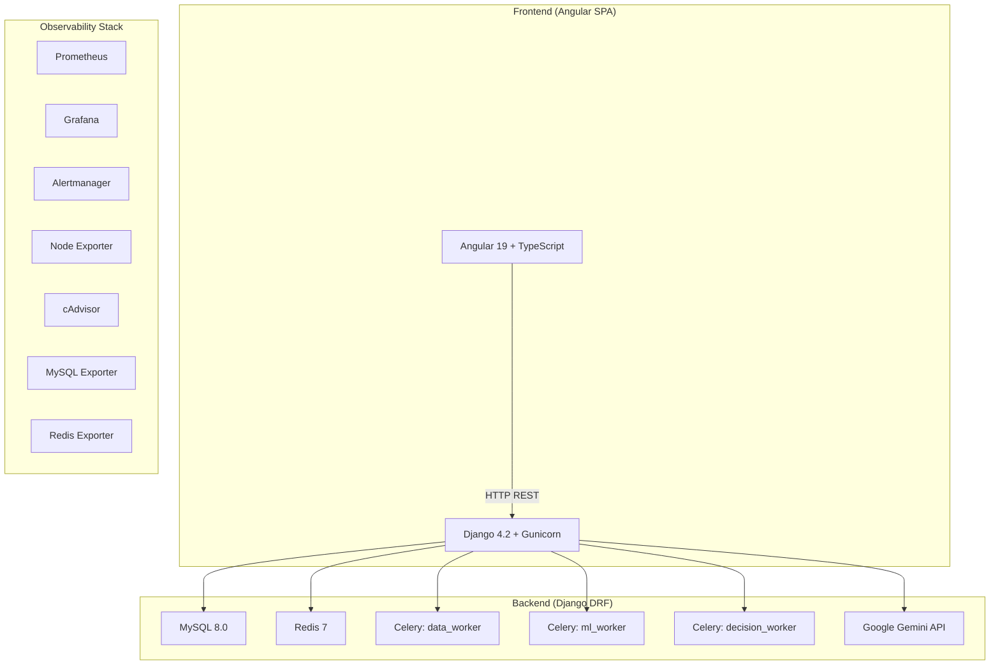
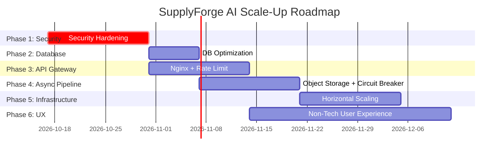

# SupplyForge AI — Scale-Up & Security Hardening Master Plan

## Mục tiêu tổng thể

Tái cấu trúc toàn diện hệ thống SupplyForge AI từ trạng thái **MVP/prototype** lên kiến trúc **production-grade** sẵn sàng cho scale-up, bao gồm:

1. **Bảo mật toàn diện** — Chống lại mọi attack vector (OWASP Top 10, API abuse, CSV injection, tenant isolation bypass)
2. **Khả năng mở rộng (Scalability)** — Xử lý hàng nghìn concurrent users với CSV files lên đến 500MB
3. **Thân thiện với user non-tech** — UI/UX wizard-style, drag-and-drop, progress visualization, Vietnamese localization
4. **Observability & Reliability** — Production monitoring, alerting, graceful degradation

---

## Phân tích hiện trạng (As-Is Architecture Audit)

### Kiến trúc hiện tại



### Những điểm mạnh đã có ✅

| Layer | Đã triển khai |
|:---|:---|
| **Auth** | JWT access/refresh tokens, email verification, account lockout (5 lần), token rotation, PII masking |
| **Rate Limiting** | Registration rate limiter (IP, fingerprint, email, phone, risk signal) + adaptive CAPTCHA |
| **Multi-Tenancy** | Workspace-based isolation, TenantIsolationMiddleware, TenantManager QuerySet filtering |
| **RBAC** | 5 roles (OWNER → VIEWER), permission decorators, 5 permission types |
| **Ingestion** | Streaming CSV profiler, SHA256 idempotency, concurrency manager, import pipeline (6 stages) |
| **ML Pipeline** | XGBoost/LightGBM risk prediction, SHAP explainability, probability calibration |
| **Monitoring** | Prometheus + Grafana + Alertmanager + Node/MySQL/Redis/cAdvisor exporters |
| **Celery** | 3 dedicated worker queues (data, ML, decision), Redis lock, cooperative cancellation |
| **Tests** | 115 test files covering auth, security, tenancy, risk, decisions |

---

## Các lỗ hổng & điểm cần cải thiện

### 🔴 CRITICAL (Phải sửa ngay — Blocking production)

Các mục dưới đây được xác nhận từ mã nguồn ban đầu. Tất cả C1–C10 đã được
triển khai trong working tree; link dùng đường dẫn tương đối để tài liệu không
phụ thuộc vào thư mục của một developer cụ thể.

| # | Issue | File | Severity | Status |
|:--|:------|:-----|:---------|:-------|
| C1 | `ALLOWED_HOSTS = ['*']` — Chấp nhận mọi Host header, làm mất lớp bảo vệ Host header | [settings.py](backend/config/settings.py#L34) | 🔴 Critical | ✅ Fixed |
| C2 | `CORS_ALLOW_ALL_ORIGINS = True` — Cho phép mọi origin gọi API | [settings.py](backend/config/settings.py#L139) | 🔴 Critical | ✅ Fixed |
| C3 | `SECRET_KEY` có fallback hardcoded — mọi môi trường thiếu secret dùng cùng một khóa JWT/Django | [settings.py](backend/config/settings.py#L29) | 🔴 Critical | ✅ Fixed |
| C4 | Credential tích hợp có default yếu hoặc trống (`ODOO_PASSWORD=admin`, secret OAuth/Gemini không được bắt buộc) | [settings.py](backend/config/settings.py#L159-L178) | 🔴 Critical | ✅ Fixed |
| C5 | `verification_code` trả lại trong response đăng ký, làm lộ token xác thực email | [auth.py](backend/supplyforge/views/auth.py#L363-L373) | 🔴 Critical | ✅ Fixed |
| C6 | Image mặc định chạy `runserver`, không phải Gunicorn production | [Dockerfile](backend/Dockerfile#L27-L31) | 🔴 Critical | ✅ Fixed |
| C7 | Database password/root password có default trong Compose và được hardcode ở Compose cũ | [docker-compose.yml](docker-compose.yml#L6-L10), [backend/docker-compose.yml](backend/docker-compose.yml#L8-L12) | 🔴 Critical | ✅ Fixed |
| C8 | JWT lỗi bị nuốt, role mặc định là `OWNER`, và request không có auth bị gán `workspace_id = 1` — nguy cơ tenant isolation/authorization bypass | [middleware.py](backend/supplyforge/middleware.py#L33-L60) | 🔴 Critical | ✅ Fixed |
| C9 | Upload và auth views trả `str(e)` cho client; ingestion còn ghi exception bằng `print()` | [ingestion.py](backend/supplyforge/views/ingestion.py#L211-L221), [auth.py](backend/supplyforge/views/auth.py#L375-L377) | 🔴 Critical | ✅ Fixed |
| C10 | `traceback` đầy đủ được trả về client trong `clear_data` | [ingestion.py](backend/supplyforge/views/ingestion.py#L382-L389) | 🔴 Critical | ✅ Fixed |

`GOOGLE_CLIENT_ID` bản thân nó là public identifier, không phải secret và không nên
được xếp Critical. Có thể chuyển nó sang cấu hình bắt buộc theo môi trường ở mục C4,
nhưng không được coi việc ẩn client ID là biện pháp bảo mật.

### Production gate cho CRITICAL

Không deploy staging/production khi chưa đạt đủ các điều kiện sau:

1. Ứng dụng fail fast nếu thiếu secret, host/origin allowlist hoặc database credential; không còn fallback production.
2. Bearer token không hợp lệ nhận HTTP `401`; request không xác thực không được tự động gán workspace/tenant.
3. Không có token, stack trace, đường dẫn nội bộ hoặc raw exception trong HTTP response hay field được trả lại từ API.
4. Web container chạy bằng Gunicorn, user không phải root; database migration chạy trong release job một lần, không chạy đồng thời khi mỗi web replica khởi động.
5. Production Compose không publish MySQL/Redis ra host và không chứa password literal/default.

**Kết quả xác minh:** `34/34` security/auth/tenant tests pass; `manage.py
check --deploy` pass với cấu hình production hợp lệ; cấu hình fail-fast khi
thiếu `DJANGO_SECRET_KEY`.

### 🟠 HIGH (Ảnh hưởng lớn đến scalability & security)

| # | Issue | Impact | Status |
|:--|:------|:------|:-------|
| H1 | Không có API-level rate limiting (chỉ có registration rate limit) | DoS attack trên mọi endpoint | ✅ Fixed |
| H2 | SQLite fallback cho tests có thể vô tình dùng trên production | Data loss | ✅ Fixed |
| H3 | `db.sqlite3` (34MB) commit trong repo | Repo bloat, security leak | ✅ Verified |
| H4 | Không có database connection pooling | Connection exhaustion khi scale | ✅ Fixed |
| H5 | Không có database read replicas | Single point of failure cho reads | 🟡 Optional topology |
| H6 | CSV files lưu trên local disk (`backend/uploads/`) | Không share được giữa nhiều instances | ✅ Fixed |
| H7 | Không có request size limiting ở reverse proxy level | Memory exhaustion attack | ✅ Fixed |
| H8 | `@csrf_exempt` trên tất cả API endpoints | CSRF vulnerability | ✅ Mitigated |
| H9 | Không có Content-Security-Policy, X-Content-Type-Options headers | XSS, MIME sniffing | ✅ Fixed |
| H10 | Một số view vẫn đọc `workspaceId`/`user_id` trực tiếp từ client thay vì trusted tenant context | Data isolation bypass | ✅ Fixed |
| H11 | TenantManager filter theo `user_id = tenant_id` (integer vs string mismatch) | Silent data leaks | ✅ Fixed |
| H12 | Không có API versioning strategy thống nhất (v1 + v2 duplicate routes) | Maintenance nightmare | ✅ Fixed |
| H13 | 459 URL routes — nhiều duplicate `/api/v1/` và `/api/v2/` | Technical debt | ✅ Fixed |
| H14 | Không có graceful shutdown / connection draining | Request drops khi deploy | ✅ Fixed |

#### HIGH implementation notes

- H1 dùng `cache.add()` + `cache.incr()` atomic theo fixed window, bật mặc định ở
  staging/production và fail-closed khi Redis/cache không khả dụng. IP chỉ được
  lấy từ `X-Forwarded-For` khi `REMOTE_ADDR` thuộc `TRUSTED_PROXY_IPS`.
- H2 không cho phép `manage.py test` hoặc `USE_SQLITE=1` khi `APP_ENV` là
  staging/production; test database dùng `:memory:`. H3 đã được xác minh không có
  `db.sqlite3` tracked và các SQLite/upload artifacts đã nằm trong `.gitignore`.
- H4 bật persistent connections với health checks; H5 có `replica` router tùy
  chọn qua `DB_REPLICA_*`, nhưng việc dựng MySQL replication vẫn là deployment
  topology, không tự tạo trong Compose.
- H6 yêu cầu `STORAGE_BACKEND=s3` ở môi trường deployed và dùng S3/MinIO-compatible
  bucket; local filesystem chỉ là backend development/test.
- H7 áp dụng đồng thời ở Nginx (`client_max_body_size`, timeout, streaming upload)
  và Django. H8 bỏ explicit exemption khỏi REST views; chỉ giữ exemption cho
  OAuth/webhook stateless hoặc external callback. H9 thêm CSP và headers ở cả
  Django lẫn frontend Nginx.
- H10/H11 dùng workspace/user đã xác thực từ JWT, không cho URL/query/body đổi
  tenant; `TenantManager` filter `workspace_id` theo integer và legacy `user_id`
  theo authenticated user string. H12 đặt version header và H13 loại route trùng,
  chuyển queue upload sang `/api/v2/jobs/upload`. H14 cấu hình Gunicorn graceful
  timeout và Compose `stop_grace_period`.

### 🟡 MEDIUM (Performance & UX improvements)

| # | Issue | Impact |
|:--|:------|:-------|
| M1 | Không có database indexing strategy rõ ràng | Slow queries khi data lớn |
| M2 | Missing `select_related` / `prefetch_related` trong ORM queries | N+1 query problems |
| M3 | Session list không paginate (hardcoded `[:50]`) | Missing data cho users có nhiều sessions |
| M4 | Không có background job cleanup / TTL | DB table bloat |
| M5 | Không có response compression (gzip/brotli) | Bandwidth waste |
| M6 | Không có CDN cho static assets | Slow global access |
| M7 | Frontend build process `|| true` bỏ qua lỗi build | Silent broken deployments |
| M8 | Không có structured logging (JSON format) | Log analysis difficulty |
| M9 | `time.sleep()` trong production code | Wasted resources |
| M10 | Không có circuit breaker cho external services (Gemini, Shopee, Odoo) | Cascading failures |
| M11 | Không có health check cho Celery workers chi tiết | Blind spots |
| M12 | Grafana admin password từ env var nhưng không enforce rotation | Credential staleness |

---

## Proposed Changes (6 Phases)

### P1 implementation status

P1 database and request-path work is implemented in the working tree. The
acceptance contract and local verification commands are maintained in
[`ops/docs/p1-acceptance.md`](ops/docs/p1-acceptance.md).

| P1 item | Implementation status |
|:---|:---|
| Persistent database connections | ✅ Configured before P1; health checks remain enabled. |
| Query-path indexes | ✅ `0062_p1_query_path_indexes` adds only model-backed indexes for active list/filter/sort paths. |
| Session history pagination | ✅ V2 envelope, default page size 20, maximum 100, compact rows and joined dataset metadata. V1 retains its list response shape. |
| Structured request observability | ✅ JSON logs, safe `X-Request-ID`, method/path/status/duration only; no body or query-string logging. |
| Edge request protection | ✅ Nginx per-IP request/connection limits, streamed CSV proxy, gzip and immutable asset caching. |
| V2 route modularization | ✅ Queue and dashboard-query routes moved to `supplyforge.urls_v2` with unchanged URLs/names. |

The P1 changes do not run Terraform, provision infrastructure, or enable an
object-storage provider. Nginx syntax should be checked inside the frontend
image by the release pipeline because this development host has no Docker
daemon access.

---

## Phase 1: 🔒 Security Hardening (Priority: P0 — Week 1-2)

> [!CAUTION]
> Phase này **PHẢI** hoàn thành trước khi deploy lên bất kỳ môi trường nào có real user data.

### 1.1 Django Security Settings

#### [MODIFY] backend/config/settings.py

```diff
 from django.core.exceptions import ImproperlyConfigured

 # SECURITY WARNING: keep the secret key used in production secret!
-SECRET_KEY = os.getenv('DJANGO_SECRET_KEY', 'django-insecure-supplyforge-ai-mvp-secret-key-change-me')
+SECRET_KEY = os.getenv('DJANGO_SECRET_KEY')
+IS_DEPLOYED = APP_ENV in {'staging', 'production'}
+if IS_DEPLOYED and not SECRET_KEY:
+    raise ImproperlyConfigured("DJANGO_SECRET_KEY is required for staging/production.")
+if not SECRET_KEY:
+    SECRET_KEY = 'django-insecure-dev-only-key-not-for-production'
+DEBUG = os.getenv('DJANGO_DEBUG', 'False').lower() in {'1', 'true', 'yes'}
+if IS_DEPLOYED and DEBUG:
+    raise ImproperlyConfigured("DJANGO_DEBUG must be false for staging/production.")

-ALLOWED_HOSTS = ['*', 'localhost', '127.0.0.1', '0.0.0.0', 'host.docker.internal']
+# Do not accept arbitrary Host headers.
+_ALLOWED_HOSTS_ENV = os.getenv('ALLOWED_HOSTS', '')
+ALLOWED_HOSTS = [
+    host.strip() for host in _ALLOWED_HOSTS_ENV.split(',') if host.strip()
+]
+if not ALLOWED_HOSTS and not IS_DEPLOYED:
+    ALLOWED_HOSTS = ['localhost', '127.0.0.1', '0.0.0.0', 'host.docker.internal']
+if IS_DEPLOYED and (not ALLOWED_HOSTS or '*' in ALLOWED_HOSTS):
+    raise ImproperlyConfigured("ALLOWED_HOSTS must be an explicit allowlist.")

-CORS_ALLOW_ALL_ORIGINS = True  # For MVP simplified connection
+CORS_ALLOW_ALL_ORIGINS = False
+CORS_ALLOWED_ORIGINS = [
+    origin.strip()
+    for origin in os.getenv('CORS_ALLOWED_ORIGINS', '').split(',')
+    if origin.strip()
+]
+if IS_DEPLOYED and not CORS_ALLOWED_ORIGINS:
+    raise ImproperlyConfigured("CORS_ALLOWED_ORIGINS is required for staging/production.")
```

Xóa block `CORS_ALLOWED_ORIGINS` cũ bên dưới để không vô tình ghi đè cấu hình
đã được validate.

Thêm security headers middleware:

```python
# Security Headers (OWASP Best Practices)
SECURE_CONTENT_TYPE_NOSNIFF = True
X_FRAME_OPTIONS = 'DENY'
SECURE_REFERRER_POLICY = 'strict-origin-when-cross-origin'

if APP_ENV == 'production':
    SECURE_PROXY_SSL_HEADER = ('HTTP_X_FORWARDED_PROTO', 'https')
    SECURE_SSL_REDIRECT = True
    SECURE_HSTS_SECONDS = 31536000
    SECURE_HSTS_INCLUDE_SUBDOMAINS = True
    SECURE_HSTS_PRELOAD = True
    SESSION_COOKIE_SECURE = True
    CSRF_COOKIE_SECURE = True
```

### 1.2 Production Secrets & Credentials

Không commit secret thật vào repository và không dùng fallback production. Các
credential bắt buộc phải được inject từ secret manager hoặc environment của
deployment:

| Secret/config | Rule |
|:--|:--|
| `DJANGO_SECRET_KEY`, `MYSQL_PASSWORD`, `MYSQL_ROOT_PASSWORD` | Bắt buộc ở staging/production; thiếu thì app fail fast |
| `ODOO_PASSWORD`, `GOOGLE_CLIENT_SECRET`, `GEMINI_API_KEY`, `S3_SECRET_KEY` | Bắt buộc khi integration tương ứng được bật; không fallback về `admin`, giá trị rỗng hoặc key mẫu |
| `GOOGLE_CLIENT_ID` | Có thể public nhưng phải cấu hình theo môi trường; không coi đây là secret |

Ví dụ guard trong `settings.py`:

```python
def required_production_secret(name, development_default=''):
    value = os.getenv(name, '').strip()
    insecure_defaults = {'change-me', 'rootpassword', 'admin', 'supplyforge'}
    if IS_DEPLOYED and (not value or value.lower() in insecure_defaults):
        raise ImproperlyConfigured(f'{name} is required for staging/production.')
    return value or development_default

MYSQL_PASSWORD = required_production_secret('MYSQL_PASSWORD', 'change-me')

ODOO_ENABLED = os.getenv('ODOO_ENABLED', 'false').lower() == 'true'
if ODOO_ENABLED:
    required_production_secret('ODOO_PASSWORD', 'admin')
```

Trong production Compose, dùng required interpolation và không publish database
hoặc Redis ra host:

```yaml
services:
  mysql:
    environment:
      MYSQL_DATABASE: ${MYSQL_DATABASE:?MYSQL_DATABASE is required}
      MYSQL_USER: ${MYSQL_USER:?MYSQL_USER is required}
      MYSQL_PASSWORD: ${MYSQL_PASSWORD:?MYSQL_PASSWORD is required}
      MYSQL_ROOT_PASSWORD: ${MYSQL_ROOT_PASSWORD:?MYSQL_ROOT_PASSWORD is required}
    # Không khai báo ports ở production.
```

`docker-compose.yml` hiện tại và `backend/docker-compose.yml` phải được đánh dấu
local-only hoặc thay bằng production Compose riêng. Không dùng các default
`supplyforge`, `rootpassword`, `supplyforge_secret_pass`, `supplyforge_root_pass`
cho môi trường có dữ liệu thật.

### 1.3 Fix Verification Code Leak

#### [MODIFY] backend/supplyforge/views/auth.py

```diff
         return JsonResponse({
             "message": "Đăng ký tài khoản thành công. Vui lòng kiểm tra mã xác thực email.",
-            "verification_code": verification_code,
             "user": {
                 "id": f"u_{user.id}",
                 "email": user.email,
```

Mã chỉ được gửi qua email provider. Cập nhật test đăng ký/xác thực để lấy mã từ
mock email/outbox hoặc fixture của test, không đọc mã từ HTTP response và không
tạo debug endpoint để phục vụ test.

### 1.4 Request Abuse Controls

Rate limiting vẫn cần có trước production, nhưng implementation cũ không phải
sliding window an toàn: `cache.get()`/`cache.set()` không atomic và
`X-Forwarded-For` có thể bị spoof nếu không có trusted proxy.

Thiết kế tối thiểu:

- Rate limit tại Nginx/API gateway theo IP và tại application theo user/workspace.
- Nếu dùng Redis, dùng `INCR` + TTL hoặc Lua script atomic; không lưu list timestamp bằng read-modify-write.
- Chỉ tin `X-Forwarded-For` từ proxy nằm trong allowlist.
- Rate limiter lỗi không được âm thầm bypass trong production; phải có alert và policy fail-closed cho auth/upload.

### 1.5 Input Validation & CSV Export Safety

Không escape HTML toàn bộ CSV lúc ingest vì sẽ làm hỏng dữ liệu nghiệp vụ và
không bảo vệ các output khác. Validate type/size ở input boundary, encode lúc
render HTML, và chỉ prefix các ô bắt đầu bằng `=`, `+`, `-`, `@` khi **export**
CSV/XLSX hoặc khi hiển thị trong spreadsheet.

### 1.6 Fix Silent Auth Failures & Tenant Context

#### [MODIFY] backend/supplyforge/middleware.py

```python
from django.http import JsonResponse

def _auth_error(code, message):
    return JsonResponse({'error': message, 'code': code}, status=401)

# Inside __call__:
if auth_header:
    if not auth_header.startswith('Bearer '):
        return _auth_error('INVALID_AUTH_HEADER', 'Yêu cầu xác thực không hợp lệ.')
    try:
        payload = jwt.decode(
            auth_header[7:].strip(),
            settings.SECRET_KEY,
            algorithms=['HS256'],
        )
    except jwt.ExpiredSignatureError:
        logger.warning('JWT rejected: expired token')
        return _auth_error('TOKEN_EXPIRED', 'Phiên đăng nhập đã hết hạn.')
    except jwt.InvalidTokenError:
        logger.warning('JWT rejected: invalid token')
        return _auth_error('INVALID_TOKEN', 'Yêu cầu xác thực không hợp lệ.')

    user_id = payload.get('user_id')
    workspace_id = payload.get('workspace_id')
    if not user_id or not workspace_id:
        return _auth_error('INVALID_TOKEN', 'Yêu cầu xác thực không hợp lệ.')
else:
    user_id = None
    workspace_id = None
    role = None

tenant_id = f"T{workspace_id:03d}" if workspace_id else None
permissions = get_user_permissions(role) if role else []

# Không lấy workspace từ header/query và không có fallback workspace_id = 1.
# Không dùng role mặc định OWNER cho request chưa xác thực; permissions phải rỗng.
# Public endpoints giữ tenant context = None; protected endpoints phải dùng
# IsAuthenticated/guard tương ứng và trả 401 nếu thiếu context.
```

Ngoài middleware, mọi endpoint đọc dữ liệu tenant phải yêu cầu authenticated
context. Không cho client chọn workspace bằng query/header rồi dùng giá trị đó
để truy vấn database.

### 1.7 Remove Information Disclosure

#### [MODIFY] backend/supplyforge/views/ingestion.py

```python
    except Exception:
        logger.exception('Ingestion profiling failed for session %s', session.id)
        session.status = 'FAILED'
        session.error_message = 'INGESTION_FAILED'
        session.save(update_fields=['status', 'error_message', 'updated_at'])
        return Response(
            {
                'error': 'Không thể xử lý file. Vui lòng thử lại hoặc liên hệ hỗ trợ.',
                'code': 'INGESTION_FAILED',
                'sessionId': str(session.id),
            },
            status=status.HTTP_500_INTERNAL_SERVER_ERROR
        )

# For clear_data:
    except Exception:
        logger.exception('Tenant data deletion failed')
        return Response({
            "error": "Không thể hoàn tất thao tác.",
            "code": "INTERNAL_SERVER_ERROR"
        }, status=status.HTTP_500_INTERNAL_SERVER_ERROR)
```

Áp dụng cùng nguyên tắc cho các `except` trong `auth.py`: log exception ở server
nhưng chỉ trả message generic và error code ổn định; không trả `str(e)`.

`_serialize_session()` cũng chỉ được trả error code/message đã được sanitize;
không serialize raw exception từ database. Log server giữ stack trace qua
`logger.exception()` và gắn request/session ID để điều tra.

### 1.8 Production Dockerfile

#### [MODIFY] backend/Dockerfile

```dockerfile
# Create runtime user before switching away from root.
RUN addgroup --system django \
    && adduser --system --ingroup django django \
    && mkdir -p /app/uploads /app/tmp \
    && chown -R django:django /app

USER django

# Web process only. Do not run migrations from every web replica.
CMD ["gunicorn", "config.wsgi:application", "--bind", "0.0.0.0:8080", "--workers", "4", "--threads", "2", "--timeout", "120", "--max-requests", "1000", "--max-requests-jitter", "50", "--access-logfile", "-", "--error-logfile", "-", "--log-level", "info"]
```

Chạy migration như release job trước khi traffic chuyển sang release mới:

```bash
docker compose -f docker-compose.prod.yml run --rm backend python manage.py migrate --noinput
docker compose -f docker-compose.prod.yml up -d backend
```

Nếu vẫn giữ `backend/docker-compose.yml`, phải đổi WSGI module thành
`config.wsgi:application` và không dùng các credential literal trong file này.

---

## Phase 2: 🗄️ Database & Performance Optimization (Priority: P1 — Week 2-3)

### 2.1 Database Connection Pooling

#### [MODIFY] backend/config/settings.py

```python
# Database Connection Pooling (prevents connection exhaustion under load)
DATABASES = {
    'default': {
        'ENGINE': 'django.db.backends.mysql',
        'NAME': MYSQL_DB,
        'USER': MYSQL_USER,
        'PASSWORD': MYSQL_PASSWORD,
        'HOST': MYSQL_HOST,
        'PORT': MYSQL_PORT,
        'CONN_MAX_AGE': 600,  # 10 minutes persistent connections
        'CONN_HEALTH_CHECKS': True,
        'OPTIONS': {
            'charset': 'utf8mb4',
            'init_command': "SET sql_mode='STRICT_TRANS_TABLES'",
            'connect_timeout': 10,
            'read_timeout': 30,
            'write_timeout': 30,
        },
    }
}
```

### 2.2 Critical Database Indexes

#### [NEW] backend/supplyforge/migrations/0xxx_performance_indexes.py

```python
"""Add performance-critical database indexes for scale-up."""
from django.db import migrations

class Migration(migrations.Migration):
    dependencies = [
        ('supplyforge', '0001_initial'),  # adjust to latest
    ]

    operations = [
        # Products — critical for analytics queries
        migrations.RunSQL(
            "CREATE INDEX IF NOT EXISTS idx_products_user_id ON products(user_id);",
            reverse_sql="DROP INDEX idx_products_user_id ON products;"
        ),
        migrations.RunSQL(
            "CREATE INDEX IF NOT EXISTS idx_products_item_sku ON products(item_sku);",
            reverse_sql="DROP INDEX idx_products_item_sku ON products;"
        ),
        migrations.RunSQL(
            "CREATE INDEX IF NOT EXISTS idx_products_created_at ON products(created_at);",
            reverse_sql="DROP INDEX idx_products_created_at ON products;"
        ),

        # Orders — time-series queries
        migrations.RunSQL(
            "CREATE INDEX IF NOT EXISTS idx_orders_user_sku ON orders(user_id, sku_id);",
            reverse_sql="DROP INDEX idx_orders_user_sku ON orders;"
        ),
        migrations.RunSQL(
            "CREATE INDEX IF NOT EXISTS idx_orders_date ON orders(order_date);",
            reverse_sql="DROP INDEX idx_orders_date ON orders;"
        ),

        # Ingestion Sessions — workspace filtering
        migrations.RunSQL(
            "CREATE INDEX IF NOT EXISTS idx_ingestion_ws_status ON supplyforge_ingestionsession(workspace_id, status);",
            reverse_sql="DROP INDEX idx_ingestion_ws_status ON supplyforge_ingestionsession;"
        ),
        migrations.RunSQL(
            "CREATE INDEX IF NOT EXISTS idx_ingestion_file_hash ON supplyforge_ingestionsession(file_hash);",
            reverse_sql="DROP INDEX idx_ingestion_file_hash ON supplyforge_ingestionsession;"
        ),

        # Risk Assessments — workspace + risk level queries
        migrations.RunSQL(
            "CREATE INDEX IF NOT EXISTS idx_risk_ws_level ON supplyforge_slowmovingriskassessment(workspace_id, risk_level);",
            reverse_sql="DROP INDEX idx_risk_ws_level ON supplyforge_slowmovingriskassessment;"
        ),

        # Background Jobs — status polling
        migrations.RunSQL(
            "CREATE INDEX IF NOT EXISTS idx_jobs_ws_status ON supplyforge_backgroundjob(workspace_id, status);",
            reverse_sql="DROP INDEX idx_jobs_ws_status ON supplyforge_backgroundjob;"
        ),

        # RefreshTokens — lookup by hash
        migrations.RunSQL(
            "CREATE INDEX IF NOT EXISTS idx_refresh_token_hash ON refresh_tokens(token, is_revoked);",
            reverse_sql="DROP INDEX idx_refresh_token_hash ON refresh_tokens;"
        ),
    ]
```

### 2.3 Query Optimization (N+1 Prevention)

#### [MODIFY] backend/supplyforge/views/ingestion.py

```diff
 def ingestion_session_list(request):
     workspace_id = request.GET.get('workspaceId', 1)
-    sessions = IngestionSession.objects.filter(workspace_id=workspace_id)[:50]
+    page = int(request.GET.get('page', 1))
+    page_size = min(int(request.GET.get('pageSize', 20)), 100)
+    offset = (page - 1) * page_size
+
+    queryset = IngestionSession.objects.filter(
+        workspace_id=workspace_id
+    ).select_related('workspace').order_by('-created_at')
+
+    total_count = queryset.count()
+    sessions = queryset[offset:offset + page_size]
+
-    return Response([_serialize_session(s) for s in sessions])
+    return Response({
+        'items': [_serialize_session(s) for s in sessions],
+        'pagination': {
+            'page': page,
+            'pageSize': page_size,
+            'totalItems': total_count,
+            'totalPages': (total_count + page_size - 1) // page_size
+        }
+    })
```

### 2.4 Structured JSON Logging

#### [NEW] backend/config/logging_config.py

```python
"""Production-grade structured logging configuration."""

LOGGING = {
    'version': 1,
    'disable_existing_loggers': False,
    'formatters': {
        'json': {
            '()': 'pythonjsonlogger.jsonlogger.JsonFormatter',
            'format': '%(asctime)s %(name)s %(levelname)s %(message)s',
            'datefmt': '%Y-%m-%dT%H:%M:%S%z',
        },
        'verbose': {
            'format': '[{asctime}] {levelname} {name} {module}.{funcName}:{lineno} - {message}',
            'style': '{',
        },
    },
    'handlers': {
        'console_json': {
            'class': 'logging.StreamHandler',
            'formatter': 'json',
        },
        'console_verbose': {
            'class': 'logging.StreamHandler',
            'formatter': 'verbose',
        },
    },
    'root': {
        'handlers': ['console_json'],
        'level': 'INFO',
    },
    'loggers': {
        'django': {'level': 'WARNING', 'propagate': True},
        'django.request': {'level': 'ERROR', 'propagate': True},
        'supplyforge': {'level': 'INFO', 'propagate': True},
        'celery': {'level': 'INFO', 'propagate': True},
    },
}
```

---

## Phase 3: 🚦 API Gateway & Request Pipeline (Priority: P1 — Week 3-4)

### 3.1 Nginx Reverse Proxy Hardening

#### [MODIFY] frontend/nginx.conf → Tách thành reverse proxy config

```nginx
# ── Nginx Rate Limiting & Security Headers ──
limit_req_zone $binary_remote_addr zone=api_limit:10m rate=30r/s;
limit_req_zone $binary_remote_addr zone=upload_limit:10m rate=2r/s;
limit_conn_zone $binary_remote_addr zone=conn_limit:10m;

# ── Upload Size Limit ──
client_max_body_size 500M;
client_body_timeout 300s;
client_header_timeout 30s;

server {
    listen 80;
    server_name _;

    # ── Security Headers ──
    add_header X-Frame-Options "DENY" always;
    add_header X-Content-Type-Options "nosniff" always;
    add_header X-XSS-Protection "1; mode=block" always;
    add_header Referrer-Policy "strict-origin-when-cross-origin" always;
    add_header Content-Security-Policy "default-src 'self'; script-src 'self' 'unsafe-inline'; style-src 'self' 'unsafe-inline' https://fonts.googleapis.com; font-src 'self' https://fonts.gstatic.com; img-src 'self' data: blob:;" always;

    # ── API Proxy ──
    location /api/ {
        limit_req zone=api_limit burst=50 nodelay;
        limit_conn conn_limit 20;

        proxy_pass http://backend:8080;
        proxy_set_header Host $host;
        proxy_set_header X-Real-IP $remote_addr;
        proxy_set_header X-Forwarded-For $proxy_add_x_forwarded_for;
        proxy_set_header X-Forwarded-Proto $scheme;
        proxy_read_timeout 120s;
    }

    # ── Upload Endpoint (stricter limits) ──
    location /api/v2/ingestion/upload {
        limit_req zone=upload_limit burst=3 nodelay;
        limit_conn conn_limit 5;

        client_max_body_size 500M;
        proxy_pass http://backend:8080;
        proxy_set_header Host $host;
        proxy_set_header X-Real-IP $remote_addr;
        proxy_read_timeout 600s;  # 10 min for large CSV uploads
    }

    # ── Static Assets (with cache) ──
    location / {
        root /usr/share/nginx/html;
        try_files $uri $uri/ /index.html;

        location ~* \.(js|css|png|jpg|jpeg|gif|ico|svg|woff|woff2)$ {
            expires 30d;
            add_header Cache-Control "public, immutable";
        }
    }

    # ── Health Check ──
    location /health/ {
        proxy_pass http://backend:8080;
        access_log off;
    }
}
```

### 3.2 Response Compression

#### [MODIFY] backend/config/settings.py — Add GZip middleware

```diff
 MIDDLEWARE = [
     'django_prometheus.middleware.PrometheusBeforeMiddleware',
+    'django.middleware.gzip.GZipMiddleware',
     'corsheaders.middleware.CorsMiddleware',
+    'supplyforge.middleware.api_rate_limiter.APIRateLimiterMiddleware',
     'django.middleware.security.SecurityMiddleware',
```

### 3.3 URL Route Consolidation

#### [NEW] backend/supplyforge/urls_v1.py & urls_v2.py

Tách `urls.py` (459 lines) thành module-based routing:

```python
# backend/supplyforge/urls/__init__.py
from django.urls import path, include

urlpatterns = [
    path('', include('supplyforge.urls.health')),
    path('api/v1/', include('supplyforge.urls.v1')),
    path('api/v2/', include('supplyforge.urls.v2')),
    path('api/', include('supplyforge.urls.shared')),
]
```

---

## Phase 4: ⚡ Async Pipeline & File Storage (Priority: P2 — Week 4-6)

### 4.1 Object Storage for CSV Files

Thay thế local disk storage bằng S3-compatible object storage (MinIO cho self-hosted hoặc AWS S3):

#### [NEW] backend/supplyforge/services/storage_backend.py

```python
"""
Pluggable File Storage Backend.
Supports local filesystem (development) and S3/MinIO (staging/production).
"""
import os
import boto3
from django.conf import settings

class StorageBackend:
    @classmethod
    def get_backend(cls):
        backend_type = os.getenv('STORAGE_BACKEND', 'local')
        if backend_type == 's3':
            return S3StorageBackend()
        return LocalStorageBackend()

class LocalStorageBackend:
    def save_file(self, file_obj, path):
        os.makedirs(os.path.dirname(path), exist_ok=True)
        with open(path, 'wb') as f:
            for chunk in file_obj.chunks():
                f.write(chunk)
        return path, os.path.getsize(path)

    def get_file(self, path):
        return open(path, 'rb')

    def delete_file(self, path):
        if os.path.exists(path):
            os.remove(path)

class S3StorageBackend:
    def __init__(self):
        self.client = boto3.client(
            's3',
            endpoint_url=os.getenv('S3_ENDPOINT_URL'),
            aws_access_key_id=os.getenv('S3_ACCESS_KEY'),
            aws_secret_access_key=os.getenv('S3_SECRET_KEY'),
        )
        self.bucket = os.getenv('S3_BUCKET', 'supplyforge-uploads')

    def save_file(self, file_obj, path):
        self.client.upload_fileobj(file_obj, self.bucket, path)
        response = self.client.head_object(Bucket=self.bucket, Key=path)
        return f"s3://{self.bucket}/{path}", response['ContentLength']

    def get_file(self, path):
        key = path.replace(f"s3://{self.bucket}/", "")
        response = self.client.get_object(Bucket=self.bucket, Key=key)
        return response['Body']

    def delete_file(self, path):
        key = path.replace(f"s3://{self.bucket}/", "")
        self.client.delete_object(Bucket=self.bucket, Key=key)
```

### 4.2 Circuit Breaker for External Services

#### [NEW] backend/supplyforge/services/circuit_breaker.py

```python
"""
Circuit Breaker pattern for external API calls (Gemini, Shopee, Odoo).
Prevents cascading failures when downstream services are unavailable.
"""
import time
import threading
import logging
from functools import wraps

logger = logging.getLogger(__name__)

class CircuitBreaker:
    STATE_CLOSED = 'CLOSED'      # Normal operation
    STATE_OPEN = 'OPEN'          # All calls fail-fast
    STATE_HALF_OPEN = 'HALF_OPEN' # Testing recovery

    def __init__(self, name, failure_threshold=5, recovery_timeout=60, expected_exceptions=(Exception,)):
        self.name = name
        self.failure_threshold = failure_threshold
        self.recovery_timeout = recovery_timeout
        self.expected_exceptions = expected_exceptions
        self.failure_count = 0
        self.last_failure_time = None
        self.state = self.STATE_CLOSED
        self._lock = threading.Lock()

    def call(self, func, *args, **kwargs):
        with self._lock:
            if self.state == self.STATE_OPEN:
                if time.time() - self.last_failure_time > self.recovery_timeout:
                    self.state = self.STATE_HALF_OPEN
                    logger.info(f"[CircuitBreaker:{self.name}] Transitioning to HALF_OPEN")
                else:
                    raise CircuitBreakerOpenError(
                        f"Circuit breaker '{self.name}' is OPEN. "
                        f"Service unavailable, retry after {self.recovery_timeout}s."
                    )

        try:
            result = func(*args, **kwargs)
            with self._lock:
                self.failure_count = 0
                if self.state == self.STATE_HALF_OPEN:
                    self.state = self.STATE_CLOSED
                    logger.info(f"[CircuitBreaker:{self.name}] Recovery confirmed → CLOSED")
            return result
        except self.expected_exceptions as e:
            with self._lock:
                self.failure_count += 1
                self.last_failure_time = time.time()
                if self.failure_count >= self.failure_threshold:
                    self.state = self.STATE_OPEN
                    logger.error(
                        f"[CircuitBreaker:{self.name}] OPENED after {self.failure_count} failures"
                    )
            raise

class CircuitBreakerOpenError(Exception):
    pass

# Pre-configured circuit breakers
gemini_breaker = CircuitBreaker('gemini', failure_threshold=3, recovery_timeout=120)
shopee_breaker = CircuitBreaker('shopee', failure_threshold=5, recovery_timeout=60)
odoo_breaker = CircuitBreaker('odoo', failure_threshold=5, recovery_timeout=300)
```

### 4.3 Background Job Cleanup

#### [NEW] backend/supplyforge/management/commands/cleanup_jobs.py

```python
"""Management command to clean up old background jobs and expired sessions."""
from django.core.management.base import BaseCommand
from django.utils import timezone
from datetime import timedelta

class Command(BaseCommand):
    help = 'Clean up old background jobs, expired sessions, and revoked tokens'

    def add_arguments(self, parser):
        parser.add_argument('--days', type=int, default=30)
        parser.add_argument('--dry-run', action='store_true')

    def handle(self, *args, **options):
        days = options['days']
        dry_run = options['dry_run']
        cutoff = timezone.now() - timedelta(days=days)

        from supplyforge.models import BackgroundJob, IngestionSession, RefreshToken

        # Clean old completed/failed jobs
        old_jobs = BackgroundJob.objects.filter(
            created_at__lt=cutoff,
            status__in=['COMPLETED', 'FAILED', 'CANCELLED']
        )
        job_count = old_jobs.count()
        if not dry_run:
            old_jobs.delete()

        # Clean expired refresh tokens
        expired_tokens = RefreshToken.objects.filter(expires_at__lt=timezone.now())
        token_count = expired_tokens.count()
        if not dry_run:
            expired_tokens.delete()

        prefix = "[DRY RUN] " if dry_run else ""
        self.stdout.write(f"{prefix}Cleaned {job_count} old jobs, {token_count} expired tokens")
```

---

## Phase 5: 🏗️ Infrastructure & Horizontal Scaling (Priority: P2 — Week 6-8)

### 5.1 Docker Compose cho Production Scale

#### [NEW] docker-compose.prod.yml

```yaml
services:
  # Nginx Load Balancer / Reverse Proxy
  nginx:
    image: nginx:1.25-alpine
    volumes:
      - ./ops/nginx/nginx.prod.conf:/etc/nginx/nginx.conf:ro
    ports:
      - "80:80"
      - "443:443"
    depends_on:
      - backend-1
      - backend-2
    deploy:
      resources:
        limits:
          memory: 256M
          cpus: '0.5'

  # Horizontal-scaled Backend
  backend-1:
    build: ./backend
    environment:
      - GUNICORN_WORKERS=4
      - GUNICORN_THREADS=2
    deploy:
      resources:
        limits:
          memory: 1G
          cpus: '2.0'

  backend-2:
    build: ./backend
    environment:
      - GUNICORN_WORKERS=4
      - GUNICORN_THREADS=2
    deploy:
      resources:
        limits:
          memory: 1G
          cpus: '2.0'

  # Separate Celery workers with resource limits
  celery_data:
    build: ./backend
    command: celery -A config worker -l info -Q data_worker -c 4 -n data@%h
    deploy:
      resources:
        limits:
          memory: 2G    # Extra for CSV processing
          cpus: '2.0'

  celery_ml:
    build: ./backend
    command: celery -A config worker -l info -Q ml_worker -c 2 -n ml@%h
    deploy:
      resources:
        limits:
          memory: 4G    # ML models need more RAM
          cpus: '4.0'

  # MySQL with Read Replica
  mysql-primary:
    image: mysql:8.0
    command: >
      --default-authentication-plugin=mysql_native_password
      --innodb-buffer-pool-size=1G
      --innodb-log-file-size=256M
      --max-connections=200
      --slow-query-log=1
      --slow-query-log-file=/var/log/mysql/slow.log
      --long-query-time=1

  # Redis with persistence
  redis:
    image: redis:7-alpine
    command: >
      redis-server
      --maxmemory 512mb
      --maxmemory-policy allkeys-lru
      --save 60 1000
      --appendonly yes
```

### 5.2 Celery Beat for Scheduled Maintenance

#### [NEW] backend/config/celery_beat_schedule.py

```python
"""Celery Beat scheduled tasks for automated maintenance."""
from celery.schedules import crontab

CELERY_BEAT_SCHEDULE = {
    # Clean up old jobs daily at 3 AM
    'cleanup-old-jobs': {
        'task': 'supplyforge.tasks.cleanup_old_data',
        'schedule': crontab(hour=3, minute=0),
        'args': (30,),  # 30 days retention
    },
    # Refresh dashboard cache every 15 minutes
    'cache-warm-dashboard': {
        'task': 'supplyforge.tasks.warm_all_caches',
        'schedule': crontab(minute='*/15'),
    },
    # Risk monitoring check every 6 hours
    'risk-monitoring': {
        'task': 'supplyforge.tasks.execute_risk_monitoring_check',
        'schedule': crontab(hour='*/6', minute=0),
    },
}
```

---

## Phase 6: 🎯 Non-Tech User UX Enhancement (Priority: P2 — Week 6-10)

### 6.1 Upload Wizard Flow (Step-by-step)

Thiết kế lại flow upload CSV thành wizard 5 bước cho user non-tech:

```
Bước 1: Kéo thả file CSV    → Drag & Drop zone + file picker
Bước 2: Xem trước dữ liệu   → Bảng preview 10 rows đầu + thống kê cơ bản
Bước 3: Xác nhận ánh xạ cột  → AI auto-mapping + cho phép chỉnh sửa
Bước 4: Kiểm tra chất lượng  → Health score visualization + warnings
Bước 5: Xử lý & Hoàn tất    → Progress bar animation + thông báo kết quả
```

### 6.2 Vietnamese Error Messages with Suggestions

```typescript
// Ví dụ error messages thân thiện cho non-tech users
const ERROR_MESSAGES = {
  'RATE_LIMIT_EXCEEDED': {
    title: '⏳ Quá nhiều yêu cầu',
    message: 'Hệ thống đang xử lý yêu cầu trước đó. Vui lòng chờ {retry_after} giây.',
    suggestion: 'Mẹo: Chờ một lát rồi thử lại nhé!',
    icon: '⏰'
  },
  'INVALID_CSV': {
    title: '📄 File không đúng định dạng',
    message: 'File bạn tải lên không phải định dạng CSV.',
    suggestion: 'Mẹo: Mở file trong Excel → File → Save As → chọn "CSV UTF-8"',
    icon: '📊'
  },
  'FILE_TOO_LARGE': {
    title: '📦 File quá lớn',
    message: 'File vượt quá giới hạn 500MB ({actual_size}).',
    suggestion: 'Mẹo: Chia file thành nhiều phần nhỏ hơn, mỗi phần dưới 500MB',
    icon: '✂️'
  }
};
```

### 6.3 Real-time Progress Notification

Tích hợp WebSocket hoặc Server-Sent Events (SSE) cho real-time progress:

```python
# backend/supplyforge/views/sse_progress.py
from django.http import StreamingHttpResponse
import json, time

def stream_job_progress(request, job_id):
    """Server-Sent Events endpoint for real-time job progress."""
    def event_stream():
        from supplyforge.models import BackgroundJob
        while True:
            try:
                job = BackgroundJob.objects.get(id=job_id)
                data = json.dumps({
                    'status': job.status,
                    'progress': job.progress_pct,
                    'stage': job.current_stage,
                    'stages': job.stages_json,
                })
                yield f"data: {data}\n\n"
                if job.status in ['COMPLETED', 'FAILED', 'CANCELLED']:
                    break
                time.sleep(2)
            except Exception:
                break

    response = StreamingHttpResponse(event_stream(), content_type='text/event-stream')
    response['Cache-Control'] = 'no-cache'
    response['X-Accel-Buffering'] = 'no'
    return response
```

---

## User Review Required

> [!IMPORTANT]
> **Quyết định cần xác nhận trước khi triển khai:**
>
> 1. **File Storage Backend**: Sử dụng **MinIO (self-hosted S3)** hay **AWS S3** cho production? MinIO phù hợp nếu muốn giữ control on-premise; S3 nếu deploy lên cloud.
>
> 2. **Database Read Replica**: Có cần MySQL read replica ngay Phase 5 không, hay chờ khi traffic thực sự cần?
>
> 3. **URL Route Consolidation**: Có giữ backward compatibility cho v1 API routes hay deprecated hoàn toàn?
>
> 4. **Frontend Framework**: Angular hiện tại hay migrate sang framework khác (Next.js/Nuxt.js) cho SSR & SEO?
>
> 5. **WebSocket vs SSE**: Ưu tiên WebSocket (hai chiều) hay SSE (một chiều, đơn giản hơn) cho real-time progress?

> [!WARNING]
> **Breaking Changes tiềm ẩn:**
> - Loại bỏ `CORS_ALLOW_ALL_ORIGINS` sẽ yêu cầu frontend phải config đúng origin
> - Loại bỏ `workspace_id` default = 1 sẽ yêu cầu tất cả request phải gửi kèm authentication
> - Dockerfile chuyển sang non-root user có thể ảnh hưởng đến volume mounts
> - `verification_code` không trả về response nữa → cần test luồng email thực

---

## Open Questions

> [!IMPORTANT]
> 1. **Target concurrent users là bao nhiêu?** (100? 1,000? 10,000?) — Ảnh hưởng trực tiếp đến infra sizing
> 2. **Deployment target là gì?** (VPS tự quản? AWS ECS? Kubernetes? Render.com?) — Quyết định Phase 5 strategy
> 3. **CSV file trung bình bao nhiêu rows?** (10K? 100K? 1M?) — Ảnh hưởng Celery worker sizing
> 4. **Budget cho infrastructure?** — Ảnh hưởng quyết định managed services vs self-hosted
> 5. **Có cần audit trail / compliance (SOC2, GDPR)?** — Ảnh hưởng data retention & logging strategy

---

## Verification Plan

### Automated Tests

```bash
# Phase 1: Security
APP_ENV=production python manage.py check --deploy
python manage.py test supplyforge.tests.test_sec_auth_001 -v 2
python manage.py test supplyforge.tests.test_sec_auth_002 -v 2
python manage.py test supplyforge.tests.test_sec_auth_003_004 -v 2
python manage.py test supplyforge.tests.test_phase3_security_pyramid -v 2
# Add regression tests for invalid JWT -> 401, no default tenant, and
# registration response not containing verification_code.

# Phase 2: Database & Performance
python manage.py showmigrations
python manage.py migrate --check
python manage.py test supplyforge.tests.test_query_service -v 2

# Full suite
python manage.py test supplyforge.tests -v 2 --parallel
```

### Manual Verification

| Check | How | Expected |
|:------|:----|:---------|
| CORS blocked | `curl -H "Origin: https://evil.com" http://localhost:8080/api/v1/ping` | Missing CORS headers |
| Production config fails closed | Start with `APP_ENV=production` and omit one required secret/origin | Startup/check fails; no insecure fallback |
| Invalid JWT | Call a protected endpoint with a malformed/expired bearer token | HTTP 401; no workspace/tenant is attached |
| Verification token privacy | Register a user and inspect the JSON response | No `verification_code` field |
| No debug info | Trigger 500 error | No traceback in response |
| Gunicorn | `docker exec backend ps aux` | gunicorn processes visible |
| Non-root container | `docker exec backend whoami` | `django` (not root) |
| Migration safety | Scale web service to 2+ replicas during deploy | Migration runs once as release job; web containers only start Gunicorn |
| Database exposure | `docker compose -f docker-compose.prod.yml config` | No host ports for MySQL/Redis; no password literal/default |
| DB indexes | `SHOW INDEX FROM products;` | Expected indexes present |
| Response compression | `curl -H "Accept-Encoding: gzip" ... \| wc -c` | Compressed response smaller |

---

## Tổng kết Priority Roadmap


